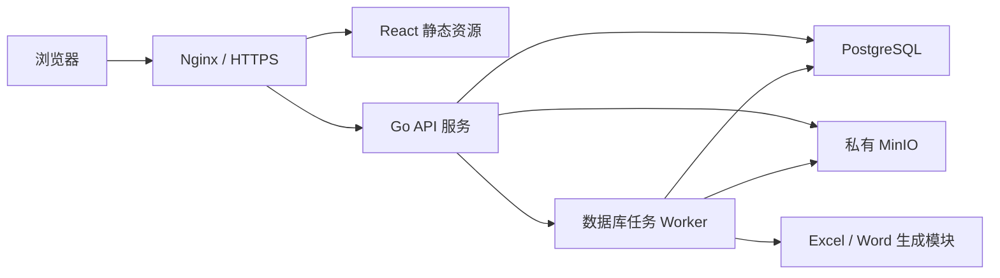
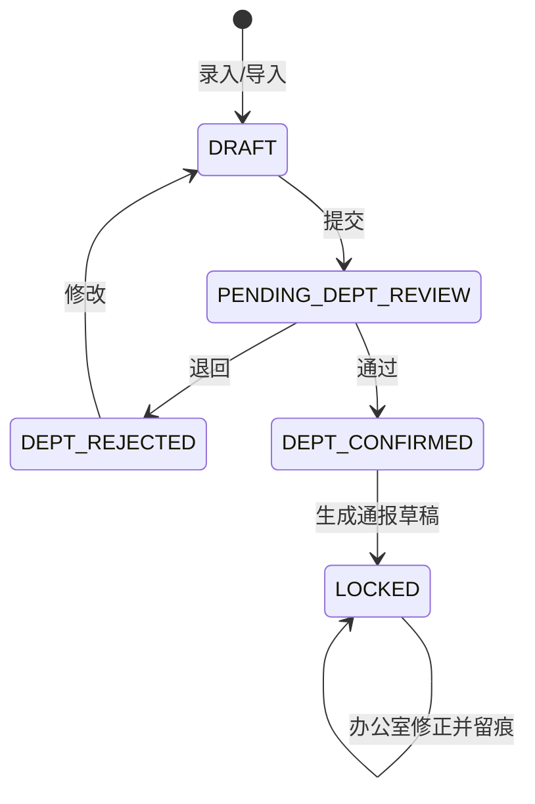
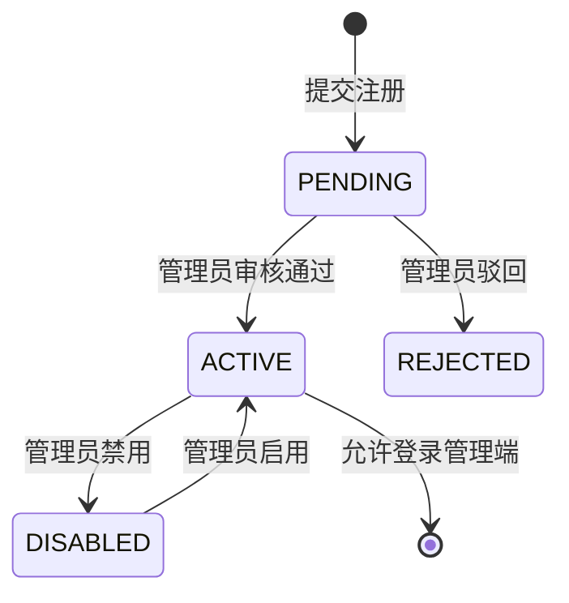

# 计算机学院日常管理系统技术方案

> **2026-10-25 晚自习补充（优先于 10-04 的五类历史范围）：** 已确认新增 `EVENING_SELF_STUDY`。它使用独立详情表，不关联课程；只录缺勤学生，固定第 9–10 节和 2 学时；参加周通报并沿用逐周应交/零回执流程。具体部门映射和应交周次待部门确定后配置。工作区正在实施，迁移 030 未应用；当前验收范围为原五类加晚自习目标六类，教室卫生和公共宿舍卫生仍暂停专项验收。

> **2026-10-04 最新范围决定（优先于下文旧计划和历史记录）：** 当前后续开发及本批验收仅包含到课率、无机课堂、早锻炼/早签、宿舍卫生、晚归五类。教室卫生、公共宿舍卫生列为待需求方确认，暂停后续开发；保留已有功能、数据及未来汇总通报接入能力，不删除、不据此隐藏入口。具体方案经用户确认并同步文档后再实施。完整七类规划保留，当前五类验收与两类延期分开记录。见[范围决定](2026-10-04-five-inspection-active-scope.md)。部门提交分组建议尚未批准。

> **2026-10-25 课程简化决定（优先于下文课程排课设计）：** 课程业务模型只维护课程名和启用状态；不维护教师、班级或排课。检查记录单独保存学生/班级、发生时间、教室和节次，课程只用于标识记录。课程模糊搜索分页，不再按日期/班级/教室/节次匹配。旧数据库列和关系表暂保留历史数据，但应用不再读取/写入其关系校验；物理删除需另行确认。见[课程简化实施记录](./2026-10-25-course-master-simplification.md)。

> 版本：v1.1（实现事实同步，未新增架构决策）
> 初稿：2026-07-11；核对：2026-09-20
> 依据：《PRD-计算机学院日常管理系统》  
> 目标部署：Linux 云服务器或校内服务器

> 当前交付、运行状态和后续任务见[项目状态](../project-status.md)。本文仍包含阶段三/四的目标设计；出现实体/API 设计不代表代码已实现。以下技术栈按当前 package.json/go.mod/配置核对，未引入新依赖。

## 1. 方案结论

### 1.1 当前技术栈与后续目标

| 层次 | 技术选型 | 说明 |
| --- | --- | --- |
| Web 前端 | React 19、TypeScript、Vite 7、Ant Design 6、ProComponents | 当前复杂列表沿用 ProTable 原生查询/工具栏 |
| 前端状态 | TanStack Query、React Context、React Router 7 | Query 管服务端状态，现有 AuthProvider 管登录上下文；未引入 Zustand |
| 后端 | Go 1.25+、Gin、pgx/v5 | 当前仓储使用参数化 SQL，无 GORM/sqlc 依赖 |
| API | /api/v1 RESTful API、手写 TypeScript Client | OpenAPI 生成式契约为后续目标，当前未交付；错误结构尚需统一 |
| 数据库 | PostgreSQL 16+ | 事务、约束、JSONB、窗口函数和复杂统计能力较强 |
| 缓存/任务 | MVP 可不部署 Redis；异步任务先用数据库任务表 | 降低运维复杂度；任务量增加后再引入 Redis/Asynq |
| 文件存储 | 私有 MinIO | 所有环境统一使用，不提供本地目录分支 |
| Excel | excelize | Go 原生、适合模板、导入校验和导出 |
| Word（阶段三规划） | docx 模板占位符 + OOXML 处理 | 尚未交付生成/定稿链路 |
| 认证 | 内部账号密码、JWT 短令牌 + HttpOnly Refresh Cookie | 支持禁用、续期和会话撤销 |
| 部署 | Docker Compose、Nginx、HTTPS | 单机可完整部署，未来可迁移到 Kubernetes |
| 可观测性 | 当前有日志、审计与 live/ready | 统一结构化日志及 Prometheus 属于后续完善项，不代表已装配 |

### 1.2 架构选择

推荐“模块化单体”，不在 MVP 阶段拆微服务。系统账号量、并发量和数据规模都不需要微服务，业务难点主要在权限、审核状态、文件生成与历史追溯。模块化单体能保证一个事务内完成“数据修正—版本记录—状态变化—审计日志”，部署和备份也更简单。

备选方案：

1. Go 模块化单体（推荐）：开发、部署、事务和运维成本最低。
2. Go API + Python 文档服务：只有在 Word 模板复杂到 Go 库难以处理时采用，会增加服务治理成本。
3. 全 TypeScript：前后端类型共享更直接，但既然团队已选择 Go，且本系统强调稳定批处理和部署简洁，不作为首选。

## 2. 总体架构



后端按领域划分模块，但以一个 API 进程和一个可独立启动的 Worker 进程交付。两者复用同一代码仓库和领域服务。文件解析、统计快照、Word/Excel 生成放入任务队列，避免阻塞 HTTP 请求。

建议仓库结构：

```text
four-check-management-system/
├── web/                         # React 前端
├── server/
│   ├── cmd/api/                 # HTTP 服务入口
│   ├── cmd/worker/              # 异步任务入口
│   ├── internal/
│   │   ├── auth/                # 认证、会话
│   │   ├── iam/                 # 用户、角色、权限
│   │   ├── organization/        # 部门、组织角色
│   │   ├── academic/            # 学生、班级、课程、周次
│   │   ├── inspection/          # 检查记录和审核
│   │   ├── importjob/           # Excel 导入
│   │   ├── report/              # 通报、版本、快照
│   │   ├── template/            # 模板管理
│   │   ├── archive/             # 文件和归档
│   │   ├── audit/               # 审计日志
│   │   └── platform/            # DB、存储、配置、日志
│   ├── migrations/
│   └── openapi/
├── deploy/                      # Compose、Nginx、备份脚本
└── docs/
```

## 3. 领域划分与核心数据流

### 3.1 领域模块

| 模块 | 主要职责 |
| --- | --- |
| IAM | 注册审核、登录、用户状态、角色、授权、有效权限解释 |
| 组织 | 部门、组织角色、部门与检查类型映射 |
| 教务基础数据 | 学生、班级、教职工、宿舍、教室、课程、学期周次 |
| 检查业务 | 七类检查统一流程、明细扩展字段、部门提交和审核 |
| 导入 | 模板下载、文件上传、解析、校验预览、提交和回滚 |
| 统计 | 实时统计、通报统计、处分规则匹配 |
| 通报 | 草稿、审核、退回、通报内修正、定稿、更正、发布、归档 |
| 文件与模板 | Word/Excel 模板、生成物、原始文件、下载鉴权 |
| 审计 | 关键操作、字段变化、状态流转和权限变化留痕 |

### 3.2 主流程



通报状态：`NOT_GENERATED → DRAFT → PENDING_REVIEW → REJECTED → DRAFT → FINALIZED → PUBLISHED → ARCHIVED`。`FINALIZED` 后不可退回或原位修改；修正时创建关联原通报的 `CORRECTION` 新版本。

同一学期的每个周次对应一份逻辑上的合并周通报，包含该周获准纳入的检查类型，不按检查类型拆成多份通报。源数据变化后，引用该数据的未定稿版本显示待重新生成提示（不另增通报生命周期状态）；数据应先按平台权限和修正流程在系统内修改，已锁定数据走通报内修正流程。默认由有权人员手动点击重新生成。系统可配置“手动”或“自动”触发，自动触发也必须创建新的通报版本，并据该版本重新生成关联的 Word/Excel 产物，不得静默覆盖旧版本；若存在未完成数据，自动模式仍须阻断，强制生成只能由有权用户手动填写理由后执行。定稿后的源数据更正走更正版本或补充记录。

**完整性门禁口径（2026-10-25 已确认）：** 每周应交单元通过受控配置按学期/周次、部门或校级范围、检查类型单独维护，不从 `department_inspection_scopes.can_enter` 推导。该配置由学生会办公室部长或指定负责通报的副部长管理，使用独立授权动作并审计。系统支持显式零记录回执以区分“已检查且确认零条”与“未提交”；回执沿用现有检查录入权限提交、部门审核权限确认，说明可选。未完成应交项默认阻止生成。

**周期选择默认值（2026-10-25 已确认）：** 通报汇总页周期下拉应默认选择系统工作上下文中的当前周（包含有效临时覆盖），并且该周必须在当前用户可查看的周期选项中。没有当前工作周或当前周不可查看时不预选任何选项，不得把下拉列表第一项当作当前周；用户仍可手动选择其他有权周期。

若已确认零记录回执后发现实际记录，新增实际记录提交批次；保留零回执及确认修订作为不可变历史，不覆盖、删除或转换原批次。完整性视图应分别呈现两条提交历史及其状态。

所有状态迁移必须由领域服务校验“当前状态 + 动作权限 + 数据范围”，禁止 Controller 直接更新状态字段。

## 4. 数据库设计

### 4.1 通用约定

- 主键使用 UUIDv7，跨环境导入不冲突且大致按时间有序。
- 时间字段统一存 `timestamptz`，API 返回 ISO 8601；业务日期使用 `date`。
- 核心业务表含 `created_at`、`created_by`、`updated_at`、`updated_by`、`version`。
- 可维护基础数据采用 `deleted_at` 软删除或 `enabled` 禁用；定稿快照禁止删除。
- 乐观锁使用 `version`，更新语句必须携带客户端读取到的版本号。
- 枚举优先使用 `varchar + CHECK` 或稳定代码表，避免 PostgreSQL ENUM 难迁移。
- 身份证号、电话等敏感字段应用层加密；另存不可逆 hash 用于唯一性判断和精确检索。

### 4.2 IAM 与组织表

#### users

| 字段 | 类型 | 约束/说明 |
| --- | --- | --- |
| id | uuid | PK |
| student_no | varchar(32) | UNIQUE，登录名 |
| name | varchar(64) | 非空 |
| password_hash | varchar(255) | Argon2id 或 bcrypt |
| status | varchar(24) | PENDING/ACTIVE/DISABLED/REJECTED |
| primary_department_id | uuid | FK departments |
| approved_by/approved_at | uuid/timestamptz | 注册审核 |
| last_login_at | timestamptz | 可空 |

其他 IAM 表：

- `departments(id, code, name, enabled)`
- `system_roles(id, code, name, is_super_admin)`
- `organization_roles(id, code, name)`
- `permissions(id, code, resource, action)`，如 `inspection.submit`、`report.finalize`
- `role_permissions(role_id, permission_id)`
- `user_system_roles(user_id, role_id)`
- `user_org_roles(user_id, department_id, org_role_id, start_at, end_at)`
- `inspection_types(id, code, name, extension_kind, enabled)`
- `department_inspection_scopes(department_id, inspection_type_id, can_enter, can_view, can_review, can_export)`
- `delegated_grants(id, subject_type, subject_id, permission_code, semester_id, week_id, inspection_type_id, class_id, grade, valid_from, valid_to)`
- `user_permission_rules(id, user_id, effect, permission_code, scope_json, reason)`，仅用于少量 ALLOW/DENY 特批；DENY 优先。
- `sessions(id, user_id, refresh_token_hash, expires_at, revoked_at, ip, user_agent)`

`scope_json` 仅用于权限范围这种稀疏、可扩展配置，不承载核心业务关系。常用范围仍用独立列，以便建索引和做外键校验。

### 4.3 基础数据表

- `academic_years(id, name, start_date, end_date)`
- `semesters(id, academic_year_id, code, name, start_date, end_date, status)`
- `semester_weeks(id, semester_id, week_no, start_date, end_date, enabled)`；唯一键 `(semester_id, week_no)`，日期范围不得交叉。
- `system_settings(key, value_json, updated_by)`；临时工作周次覆盖存配置并记录审计。
- `faculties(id, name)`、`grades(id, name)`、`majors(id, faculty_id, name)`
- `staff(id, employee_no, name, gender, phone_ciphertext, faculty_id, enabled)`
- `classes(id, name, grade_id, faculty_id, major_id, head_teacher_id, expected_size, enabled)`
- `dormitory_areas(id, name)`、`dormitory_buildings(id, dormitory_area_id, name)`、`dormitories(id, dormitory_building_id, room_no, enabled)`；宿舍唯一键为 `(dormitory_building_id, room_no)`
- `students(id, student_no, name, id_card_ciphertext, id_card_hash, gender, phone_ciphertext, grade_id, faculty_id, major_id, class_id, dormitory_id, status)`
- `class_enrollments(id, student_id, class_id, start_date, end_date)`，保留转班历史。
- 当前课程业务模型为 `courses(id, name, enabled)`，课程名称全局唯一。历史物理结构中的 `teacher_id`、`course_classes` 和 `course_schedules` 保留但不再由应用维护或用于校验。
- `teaching_buildings(id, name, enabled)`、`classrooms(id, teaching_building_id, room_no, enabled)`；教室唯一键为 `(teaching_building_id, room_no)`，不维护楼层字段。
- `dictionary_types`、`dictionary_items` 只承载可配置展示项；部门、角色、检查类型等有业务关系的数据不得仅作为字典项。

以上基础数据的 `id` 均由后端生成并持久化，前端不得要求管理员填写技术标识或院系/专业/班级/课程等人工编码。`student_no`、`employee_no`、`room_no` 和教室的楼宇/房间信息是现实业务标识，不属于技术主键。下拉选择统一提交 UUID、展示完整名称；检查记录继续保存名称和年级快照，避免基础数据变化影响历史结果。

基础数据列表应解析并展示必要的业务关系名称，而非只显示本表名称或关联 ID。专业展示院系，班级展示年级/院系/专业/班主任，学生展示年级/院系/专业/班级/宿舍；课程只展示课程名、状态和操作。宿舍层级的展示名称在查询结果关联层完成拼接：宿舍楼为“宿舍区 + 宿舍楼”，宿舍为“宿舍区 + 宿舍楼 + 宿舍号”；教学楼独立维护，教室展示为“教学楼名称 + 教室号”。持久化分别保存外键与房间号，不冗余保存拼接文本。

### 4.4 检查业务表

PRD 的“统一主表 + 类型扩展表”适合本系统。主表保存所有检查共有的身份、时间、流程与审计字段；扩展表保存类型专属字段。不要将全部专属字段塞入主表，也不要只存 JSONB，否则约束、查询和统计会变弱。

#### inspection_records

| 字段 | 类型 | 说明 |
| --- | --- | --- |
| id | uuid | PK |
| inspection_type_id | uuid | FK |
| semester_id/week_id | uuid | 明确所属学期周次 |
| department_id | uuid | 数据提供部门快照 |
| student_id | uuid | 可空，例如宿舍整体优秀记录 |
| student_no_snapshot/name_snapshot | varchar | 防止基础数据变化影响历史展示 |
| class_id | uuid | 可空 |
| class_name_snapshot/grade_snapshot | varchar | 历史快照 |
| occurred_at | timestamptz | 发生/检查时间 |
| violation_count | numeric(10,2) | 默认 1 |
| remark | text | 备注 |
| source | varchar(24) | MANUAL/EXCEL/REPORT_CORRECTION/MIGRATION |
| status | varchar(32) | 检查记录状态 |
| submission_id | uuid | 当前预留字段，department_submissions 表及外键待部门流程实现 |
| import_batch_id | uuid | 可空 |
| locked_by_report_id | uuid | 草稿引用后锁定 |
| row_version | int | 乐观锁 |

当前七类对应六张业务扩展表，均以 `record_id` 为 PK/FK（字段以 005/012 迁移为准）：

- `attendance_details(record_id, course_id, absence_hours, period_text, classroom_id)`：到课率 `ATTENDANCE_RATE` 与无机课堂 `UNATTENDED_CLASSROOM` 共用。
- `evening_self_study_details(record_id, classroom_id, period_text, absence_hours, penalty_multiplier, penalty_hours)`：晚自习 `EVENING_SELF_STUDY`，不关联课程，节次固定 `9-10`、实际旷课 2 学时。
- `morning_exercise_details(record_id, absence_count)`：早锻炼/早签 `MORNING_ATTENDANCE`，一次记录固定 1。
- `dorm_hygiene_details(record_id, dormitory_id, result, reason_code, description)`。
- `late_return_details(record_id, dormitory_id)`：发生时间在主表，多人晚归拆为学生记录。
- `classroom_hygiene_details(record_id, classroom_id, area_id, result, reason_code, description)`。
- `public_dormitory_hygiene_details(record_id, area_id, result, reason_code, description)`。

卫生结果为 EXCELLENT/QUALIFIED/UNQUALIFIED 互斥枚举，责任班级/学生/寝室在独立关联表保存。主表 occurrence_kind 为 TIME/DATE/ROUND，配合 occurred_at、inspection_date、inspection_round；卫生不把多班级塞进单 class_id。区域表及管理 API/UI 已完成隔离增量验收，目标环境未加载。累计与到课率等统计不写回明细。

#### 部门提交与审核（原五类已实现；晚自习接入实施中）

- `016_department_submissions.sql` 建立按成员记录批次的 `department_submissions`，保存学期、周次、部门、检查类型、状态、修订号、乐观版本、提交/审核身份与时间、退回原因及幂等指纹。同一部门、周次、类型允许多个批次，不设置该组合的唯一约束。
- `department_submission_revisions` 保存每次提交的记录 ID 集合和结构化快照；退回后沿用原批次重提并递增修订号，允许原样重提，`017` 禁止改删历史修订。检查记录通过复合外键约束绑定同范围批次，状态变更与审计在事务内完成。
- 晚自习接入后进入同一批次提交流程；当前工作区已将类型纳入活动提交类型名单，须在迁移 030 和角色验收后才可启用。教室卫生和公共宿舍卫生已有基础模型保持不变，后续规则待需求方确定。

部门汇总状态不重复手工维护，优先由提交状态映射；如为性能缓存，应由事务内统一更新并可重建。

### 4.5 Excel 导入表

- `import_batches(id, inspection_type_id, semester_id, week_id, department_id, original_file_id, status, total_rows, valid_rows, invalid_rows, imported_rows, created_by, committed_at, rolled_back_at)`
- `import_rows(id, batch_id, row_no, raw_data_json, normalized_data_json, validation_status, errors_json, record_id)`

导入分两阶段：上传解析只写 `import_batches/import_rows`；用户确认后，在单个数据库事务或可恢复的分批事务中写业务表。回滚只允许未被提交审核、未被通报锁定的批次；否则必须走业务撤销/更正流程。

### 4.6 通报、版本和快照表

- `reports(id, report_no, semester_id, week_id, title, report_kind, parent_report_id, status, created_by, finalized_by, finalized_at, published_by, published_at, version)`
- `report_inspection_types(report_id, inspection_type_id)`
- `report_versions(id, report_id, version_no, content_json, template_version_id, change_summary, created_by, created_at)`
- `report_record_refs(report_version_id, inspection_record_id, record_version, included_data_json)`：草稿引用关系和当时数据副本。
- `report_stat_snapshots(id, report_id, report_version_id, inspection_type_id, object_type, object_id, object_name, metrics_json, generated_at)`
- `report_corrections(id, report_id, record_id, before_json, after_json, reason, corrected_by, corrected_at)`
- `report_reviews(id, report_id, report_version_id, action, comment, actor_id, created_at)`
- `report_files(id, report_id, report_version_id, file_id, purpose, format, is_final)`

同一学期的每个周次仅对应一份逻辑上的合并周通报；源数据变化产生 `report_versions` 新版本，历史版本及其文件保留。更正通报通过 `parent_report_id` 关联原通报，不覆盖原定稿。`metrics_json` 可承载不同检查类型的差异指标，但只存入已确认统计规则定义的指标；展示指标族、具体字段和公式待业务规则确认，公共检索维度必须独立成列。定稿事务应：校验状态和权限 → 冻结当前版本 → 生成/固化统计快照 → 创建文件生成任务 → 将通报置为 `FINALIZING`；所有文件成功且校验通过后才变为 `FINALIZED`。失败则保留可重试状态，不能出现“已定稿但文件缺失”。

### 4.7 文件、模板、规则和审计

- `files(id, storage_provider, bucket, object_key, original_name, content_type, size_bytes, sha256, created_by, created_at, retention_type)`
- `templates(id, code, name, type, inspection_type_id, version_no, file_id, config_json, status, effective_from, effective_to)`
- `discipline_rules(id, rule_type, inspection_type_id, lower_bound, upper_bound, suggestion_code, semester_id, enabled)`；同一生效范围阈值不得重叠。
- `audit_logs(id, actor_id, action, resource_type, resource_id, before_json, after_json, reason, request_id, ip, user_agent, created_at)`
- `async_jobs(id, type, payload_json, status, attempts, max_attempts, next_run_at, locked_at, locked_by, result_json, error_message)`

### 4.8 关键索引

- `inspection_records(week_id, inspection_type_id, status)`
- `inspection_records(student_id, occurred_at DESC)`
- `inspection_records(class_id, week_id, inspection_type_id)`
- `department_submissions(week_id, department_id, inspection_type_id, status)`
- `reports(semester_id, week_id, status)`
- 主周通报需对 `(semester_id, week_id, report_kind)` 的逻辑范围施加唯一约束；更正通报作为关联原通报的子记录，不占用主周通报唯一范围。
- `report_stat_snapshots(report_id, inspection_type_id, object_type)`
- `audit_logs(resource_type, resource_id, created_at DESC)`
- `import_rows(batch_id, validation_status)`
- 对未删除数据的唯一性要求使用 partial unique index。

## 5. 权限设计

### 5.1 模型

采用 RBAC + ABAC：RBAC 决定“可执行什么动作”，ABAC 决定“可对哪些数据执行”。最终结果综合：

```text
系统角色权限
∪ 组织角色权限
∪ 部门-检查类型映射权限
∪ 指定管理员补充授权
∪ 用户单独允许
− 用户单独拒绝
```

用户单独授权/限制只按学年、学期、周次和检查类型交集计算；不提供部门、班级或年级权限维度。账号主部门的部门 × 检查类型映射决定检查动作，但映射授予的动作按类型跨部门生效。普通成员新增或导入记录仍固定归属账号主部门。班级、年级仍是记录字段和业务筛选条件。超级管理员是唯一全局绕过者，但其操作仍记录审计。

### 5.2 鉴权落点

1. 前端菜单和按钮按权限隐藏，仅改善体验，不作为安全边界。
2. API 中间件验证身份、账号状态和基础 permission code。
3. Application/Domain Service 校验资源状态和数据范围。
4. Repository 将数据范围编译为 SQL 条件，禁止先查全量再在内存过滤。
5. 文件下载根据文件关联的通报/导入批次重新鉴权，禁止公开 object key。

通报导出的 Word/Excel 是某个结构化通报版本的只读数据产物，不提供从下载文件回写业务数据的入口。数据错误须按平台权限和修正流程在平台内修正（已锁定数据走通报内修正），再生成新版本及其文件；下载副本可在平台外调整格式或样式，但不得增删改数据内容，也不取代平台保存的版本文件。平台生成的源文件按通报版本留存并可校验内容一致性。

强制生成权限应使用独立 permission code，与一般通报汇总、审核或导出权限分开配置。授权对象限定为学生会办公室部长或其指定负责周通报的副部长（学生会办公室通报管理员），权限可按用户单独授予或撤销；其他业务部门的部长身份不自动获得该权限。该动作作用于整份合并周通报，当前权限实现仅允许按学年、学期、周次和检查类型收窄，不允许部门、班级或年级子范围；这一粒度根据合并通报规则推导，仍待业务方确认，并应在生成写接口验收前冻结。未完成项默认阻断生成；强制执行必须由有权用户在系统内手动操作并填写理由，服务端记录未完成项、理由、操作者、时间和通报范围。仅填写理由或拥有页面入口不能替代服务端授权。

提供 `GET /api/v1/users/{id}/effective-permissions`，返回权限、范围和每项来源；管理员页面可解释“为什么此用户拥有该权限”。权限变更后递增用户 `permission_version`，令牌携带的旧版本失效或触发重新加载。

## 6. 后端设计

### 6.1 分层

- Handler：HTTP 参数、响应和错误码转换。
- Application Service：用例编排、事务边界和权限调用。
- Domain：实体、状态机、校验规则、统计规则接口。
- Repository：PostgreSQL 数据访问和范围过滤。
- Infrastructure：对象存储、Excel/Word、密码、任务、日志。

禁止 Handler 直接操作 ORM；禁止把权限和状态校验散落在前端。

### 6.2 API 规范

- 前缀 `/api/v1`，JSON 字段 camelCase，数据库字段 snake_case。
- 列表统一：`page`、`pageSize`、`sort`、结构化筛选参数；返回 `items,total,page,pageSize`。
- 错误统一：`code,message,details,requestId`，字段错误在 `details.fields`。
- 创建返回 201；异步任务返回 202 和 `jobId`；乐观锁冲突返回 409；无权限返回 403。
- 写操作支持 `Idempotency-Key`，尤其是导入确认、定稿和文件生成。
- 当前接口契约由 HTTP 测试、DTO 与手写 TypeScript Client 维护。OpenAPI 与类型生成尚未交付；不得假定已自动同步调用方。

关键 API 分组：

```text
POST   /auth/register | /auth/login | /auth/refresh | /auth/logout
GET    /users/{id}/effective-permissions
GET    /semesters/{id}/weeks/current
GET    /inspection-types/available
GET    /inspection-records
POST   /inspection-records
PATCH  /inspection-records/{id}
POST   /department-submissions/{id}/submit
POST   /department-submissions/{id}/approve
POST   /department-submissions/{id}/reject
POST   /imports
GET    /imports/{id}/preview
POST   /imports/{id}/commit
POST   /imports/{id}/rollback
GET    /reports/readiness?weekId=...
POST   /reports
POST   /reports/{id}/submit-review
POST   /reports/{id}/approve
POST   /reports/{id}/reject
POST   /reports/{id}/corrections
POST   /reports/{id}/finalize
POST   /reports/{id}/correction-versions
GET    /files/{id}/download
GET    /jobs/{id}
```

### 6.3 校验策略

- 请求结构校验：必填、格式、长度、枚举。
- 引用校验：学生、班级、宿舍、课程等分别存在且启用；课程只校验自身可用，不要求与班级、日期、教室或节次存在关系。
- 一致性校验：学号与姓名匹配、学生与班级/宿舍匹配、日期属于所选周次。
- 业务校验：对应部门有该检查类型录入权、记录可编辑、阈值合法。
- 重复校验：按检查类型配置业务唯一键。例如晚归可用“学生 + 晚归时间”，旷课可用“学生 + 课程 + 日期 + 节次”。

导入校验结果必须给出行号、字段、错误码、中文说明和建议值。允许“仅导入正确行”时，界面需明确错误行未导入，且批次保留完整结果。

### 6.4 并发与事务

- 审核、锁定、定稿采用行锁或条件更新，防止两人同时操作。
- 通报生成记录所引用的 `record_version`；办公室修正必须检查版本未变化。
- 文件生成采用可重试任务，object key 使用确定性路径并以 SHA-256 校验，做到幂等。
- 统计快照和引用关系在同一数据库事务中生成；大文件渲染在事务外执行。

## 7. 前端设计

### 7.1 工程方案

- React + TypeScript + Vite。
- Ant Design 的 `Form/Table/Upload/Steps/Result/Descriptions`；复杂查询表格可用 Ant Design ProComponents 的 `ProTable`。
- TanStack Query 管理请求缓存、分页、失效和异步任务轮询。
- 当前登录上下文使用 AuthProvider/React Context，局部状态留在组件；没有 Zustand，不为文档旧方案补装依赖。
- React Router 负责路由；权限路由由后端返回的有效权限生成。
- React Hook Form 可不引入，优先统一 Ant Design Form，避免两套表单状态。
- dayjs 处理日期；decimal.js 仅在前端需要精确展示计算时使用，最终统计以后端为准。

建议目录：

```text
web/src/
├── app/                         # 应用装配，不承载业务页面
│   ├── providers/               # Auth、Query、主题等全局 Provider
│   └── router/                  # 路由表、ProtectedRoute、权限路由守卫
├── pages/                       # 路由级页面，只负责页面编排
│   ├── auth/                    # 登录、注册、注册结果
│   └── home/                    # 统一工作台页面编排
├── features/                    # 可独立复用的业务用例和业务规则
│   └── auth/model/              # 登录注册校验等认证规则，不放页面和 HTTP 基础设施
├── entities/                    # 领域 UI 模型及实体级展示能力
│   └── user/model/              # User 类型；后续增加 Student、InspectionRecord 等
├── shared/                      # 不感知具体页面和业务流程的公共能力
│   ├── api/                     # httpClient、端点 Client；未来由 OpenAPI 生成类型
│   ├── layouts/                 # AuthLayout、管理端布局等通用布局
│   ├── components/              # 权限按钮、状态标签、审计时间线
│   ├── hooks/                   # 与业务无关的通用 Hook
│   ├── styles/                  # 全局样式、设计 Token
│   └── utils/                   # 无副作用通用工具
├── test/                        # 测试环境公共配置
└── main.tsx                     # 唯一浏览器入口
```

前端依赖方向固定为：`app → pages → features → entities → shared`。上层可以组合下层，下层不得反向引用上层；同层模块之间避免通过内部路径形成循环依赖。具体约束：

- `pages` 只承载路由级页面和页面编排，不定义通用 HTTP Client、领域公共类型或全局 Provider。
- `features` 按业务能力建目录，内部可再分 `api/model/ui/hooks`；只有被多个页面复用或构成完整业务动作的代码才进入 feature。
- `entities` 保存领域类型、实体查询/展示等跨 feature 复用能力，不依赖具体页面。
- `shared` 不得包含 `auth`、`report`、`inspection` 等业务流程状态；端点 Client 可位于 `shared/api`，但 HTTP 传输、Token 注入和统一错误只由 `httpClient` 处理。
- 全局 Provider、应用启动和路由守卫位于 `app`；可复用布局位于 `shared/layouts`，业务页面位于 `pages`。
- 禁止把页面、API、Context、领域类型和工具函数因同属一个业务名而全部堆入单个 `features/<name>` 目录。

### 7.2 页面与交互

前端信息架构以《原型页面模块功能梳理》为实现基线。较早的《原型设计说明》中 8 个画板仍可作为页面视觉和交互参考，但其中“导入校验”“部门审核”不再作为一级导航。技术实现不得因为后端存在独立的 import、workflow 模块，就把技术模块直接映射为一级菜单。

#### 7.2.1 一级导航

完整产品导航规划如下，由有效权限与已实现页面共同控制入口。阶段二只开放当前实现的业务与配置，不提前展示通报或归档占位：

1. 工作台
2. 日常检查业务
3. 通报管理
4. 基础数据管理
5. 用户与权限管理
6. 系统配置
7. 历史归档

登录、注册、注册结果等属于进入管理端之前的公共认证页面，不出现在左侧一级导航中，但属于 MVP 必须实现的前端页面。

#### 7.2.2 路由与页面归属

| 一级导航 | 子页面/业务页面 | 说明 |
| --- | --- | --- |
| 工作台 | 角色化工作台 | 当前周、我的待办、本部门状态、全院通报进度按权限组合展示 |
| 日常检查业务 | 业务列表、到课率、无机课堂、教室卫生、早锻炼/早签、宿舍卫生、晚归、公共宿舍卫生 | 只展示当前用户有权访问的业务 |
| 通报管理 | 周通报列表、数据汇总与统计、通报草稿、通报审核、定稿与导出、更正版本 | 统计属于通报生成链路，不设置独立一级入口 |
| 基础数据管理 | 学生、班级、教职工/班主任、宿舍、教室、课程、学期周次 | 每类基础数据在本页面内完成导入、校验和修改记录查看 |
| 用户与权限管理 | 用户列表、注册申请审核、用户详情与权限、指定管理员配置 | 用户详情展示权限、范围及来源 |
| 系统配置 | 部门与业务映射、检查类型、字典、模板、处分规则、系统参数 | 与日常业务录入分离 |
| 历史归档 | 通报归档、统计快照、审核记录、归档文件 | 定稿快照与实时业务数据明确区分 |

学年配置以起始年份为输入，结束年份固定为起始年份 +1，服务端生成规范名称并校验年份跨度。学期编码只允许 `FIRST`（上学期）和 `SECOND`（下学期），服务端按所属学年生成完整名称；前端提供默认校历日期并允许管理员按实际安排调整。同一学年、同一学期编码依靠数据库唯一约束和服务端校验防止重复。

建议路由：

```text
/login
/register
/register/result
/account-disabled
/dashboard
/inspections
/inspections/:inspectionType
/reports
/reports/:reportId/summary
/reports/:reportId/draft
/reports/:reportId/review
/reports/:reportId/finalize
/reports/:reportId/corrections
/master-data/students | classes | staff | dormitories | classrooms | courses | weeks
/iam/users | registrations | delegated-admins
/settings/department-business | inspection-types | dictionaries | templates | discipline-rules | system
/archives
```

#### 7.2.3 登录、注册与账号状态

认证页面使用独立 `AuthLayout`，不加载管理端侧边栏。视觉风格沿用原型的深蓝主色和浅灰蓝背景，但保持表单简洁，避免做成营销首页。

**登录页 `/login`**

- 字段：学号、密码。
- 功能：密码显隐、登录、防重复提交、错误提示；MVP 不提供自助找回密码，由管理员重置。
- 登录成功后读取当前用户和有效权限，再跳转到原访问地址或工作台。
- 待审核、已禁用、已驳回账号不得进入管理端，分别展示明确状态和处理提示，不能只显示“登录失败”。
- 连续登录失败时展示通用错误和必要的限流提示，不能暴露账号是否存在。

**注册页 `/register`**

- 字段：学号、姓名、所属部门、角色申请类型、密码、确认密码。
- 所属部门和可申请组织角色由公开注册配置接口提供，不在前端写死。
- 实时校验学号格式、密码规则和两次密码一致性；最终唯一性和申请资格以后端校验为准。
- 提交成功进入注册结果页，不自动登录。

**注册结果页 `/register/result`**

- 展示申请已提交、当前状态为“待审核”、后续处理方式和返回登录入口。
- 结果页不得依赖只存在于内存中的表单数据；刷新后可通过一次性申请编号查看结果，或只展示不含敏感信息的通用成功提示。

**账号状态处理**



前端对认证和权限错误分类处理：受保护请求携带 Access Token 返回 401 时，只尝试一次静默续期并重发原请求；同一页面并发请求与启动恢复共享一次 Cookie 轮换，迟到的旧凭证 401 使用已更新凭证重试。续期明确返回 401 或新凭证重试仍返回 401 时清空本地会话和私有缓存，回到登录页并提示；续期网络故障或 5xx 保留页面状态，报告失败并允许稍后重试。403 不触发续期、不扩大权限。登录、退出、注册、续期端点不递归续期，退出或账号切换后的旧请求不得作为新账号重发。后端仍采用 15 分钟 Access Token 与 7 天 Refresh 会话，不延长短凭证来掩盖前端缺失。

2026-10-25 并发设备会话增量：每账号最多三个独立登录会话，超额登录在账号锁保护的事务中撤销最久未活动会话；刷新令牌轮换沿用稳定的逻辑会话 ID。Access Token 绑定该 ID，受保护 API 核对服务端会话以使挤出的设备下一次请求即失效，前端对 `SESSION_EVICTED` 直接清除私有缓存并提示。迁移 028 与新 API 必须成对加载；旧 Access Token 无会话 ID 时可凭有效的旧 Refresh Cookie 续期。实现和验收边界见[并发设备会话方案](2026-10-25-concurrent-device-sessions.md)。

2026-10-04 刷新持久化约束：旧会话消费与新会话保存同事务，按账号→会话顺序锁定并复核 ACTIVE 与会话版本；生成凭据失败或事务回滚不能消费旧令牌。`/auth/refresh` 仅在明确失效时返回401 `INVALID_SESSION`并清Cookie；内部故障返回500 `AUTH_SERVICE_UNAVAILABLE`且保留Cookie。成功提交后响应丢失的透明恢复仍待设计，不允许旧令牌重放。见[增量验收](../reviews/2026-10-04-refresh-atomic-rotation.md)。

同日补充：登录、访问令牌账号读取、改密和退出的内部故障同样返回500 `AUTH_SERVICE_UNAVAILABLE`，不伪造凭据无效或退出成功。改密、重置密码、禁用、账号/角色修改与刷新会话撤销、审计同事务；失败整体回滚。前端退出失败保留当前页面并允许重试；两处改密成功后仅清本地会话，不再追加退出请求。见[原子性与错误验收](../reviews/2026-10-04-auth-errors-and-account-atomicity.md)。

登录会话保存同样须在账号锁内核对ACTIVE及校验密码时的SessionVersion，拒绝改密、禁用或角色调整前读取的旧账号快照；不可先验证旧密码再无条件保存会话。见[登录签发版本保护](../reviews/2026-10-04-login-account-version.md)。

自行改密和管理员重置以读取时SessionVersion做条件更新，版本冲突返回409 `VERSION_CONFLICT`，不写密码/会话/审计；自行改密还须核对当前ACTIVE及认证actor版本，旧actor返回401。管理员重置禁用目标规则独立保留。两处前端表单阻止请求进行中重复提交，失败保留输入。见[密码并发验收](../reviews/2026-10-04-password-concurrency.md)。

#### 7.2.4 导入与审核的正确交互位置

- Excel 导入不是一级页面。用户在某个检查业务详情或某个基础数据页面点击“批量导入”，以 Modal/Drawer 或该页面的子路由完成“下载模板 → 上传 → 解析 → 错误预览 → 确认导入 → 结果”。
- 部门审核不是一级页面。部门管理员在对应检查业务详情中切换“待审核”视图，查看提交批次和明细，执行整体通过或退回；普通成员在同一业务中查看草稿、退回和已确认状态。
- 通报审核仍属于“通报管理”内部的明确子页面，因为它是另一套独立于部门审核的状态流程。
- `importjob`、`inspection`、`workflow` 等后端模块只代表代码职责边界，不决定菜单层级。

#### 7.2.5 关键页面交互

- 工作台根据普通成员、部门管理员、办公室通报管理员、查看者等角色复用同一布局并组合不同卡片，不为每个角色复制一套实现。
- 日常检查业务先显示业务卡片/列表；进入业务详情后使用统一页面骨架，动态装载类型专属筛选项、表格列和表单。
- 数据汇总与统计的筛选条件固定在顶部；汇总以部门为树状主项、负责的检查类型为可展开子项，类型行可进入分页的已确认真实记录明细。计数承担定位和状态提示，不能替代实际提交记录。统计口径、数据截止时间和未完成部门风险显式展示。
- 通报详情用步骤条表达汇总、草稿、审核、定稿、发布、归档阶段，并展示版本列表、审核时间线、办公室修正对比和文件列表。
- 源数据变化后的处理按系统触发配置运行；默认手动重新生成。自动模式配置变更须留痕，自动生成只创建关联新版本和新文件，不覆盖已有版本。
- 用户详情采用右侧 Drawer 或独立详情页，用“权限—范围—来源”表格解释有效权限，而非只显示角色名。
- 历史归档中的定稿数据明确标记“快照”，与实时数据分开展示。

检查类型差异采用配置驱动的字段元数据，但表单组件仍显式编码。不要让管理员在 MVP 任意配置数据库字段，否则校验、统计和模板都会过度复杂。

### 7.3 前端安全与可靠性

- Access Token 只放内存；Refresh Token 放 Secure、HttpOnly、SameSite Cookie。
- 所有写操作防重复提交；表单离开前提示未保存内容。
- 409 版本冲突展示“数据已被他人修改”，允许刷新后重新编辑。
- 敏感字段默认脱敏，查看明文需额外权限并记录审计。
- 大导出和通报生成显示任务进度，不保持长 HTTP 连接。

## 8. 文件、模板和归档设计

### 8.1 存储策略

所有环境统一部署或连接 MinIO，不实现本地目录存储分支。Bucket 永远私有、启用版本控制并关闭匿名访问；API 使用独立最小权限账号。对象路径示例：

```text
imports/{semester}/{week}/{batchId}/original.xlsx
templates/{type}/{templateId}/v{version}/template.docx
reports/{semester}/{week}/{reportId}/v{version}/draft.docx
reports/{semester}/{week}/{reportId}/v{version}/final.xlsx
```

数据库保存元数据、SHA-256、状态和业务关联，不保存大文件二进制。业务代码只依赖 `ObjectStorage`，但阶段 1 唯一基础设施实现为 MinIO。

### 8.2 模板方案

- Excel 导入模板：固定 machine-readable 字段编码，中文表头仅用于展示；模板内含填写说明、字典选项和示例行。
- Excel 导出：excelize 按模板填充，生成后重新打开校验 sheet、关键单元格和行数。已核对的第二周历史工作簿有六张分类明细表、没有单元格公式但保留一个外部链接记录；新模板不应未经确认地复制该链接，导出回归须检查工作表、数据范围及非预期外部链接。
- Word：使用经过审核的 docx 模板，定义段落、循环表格和条件附件占位规则；模板发布后不可覆盖，只能创建新版本。
- 每个通报版本记录模板版本、数据引用和生成文件，以保证重现。

已核对一份历史定稿 Word：共 29 页、18 个 A4 页面分节（首页纵向，其余横向）、24 张表，正文后有 6 组附件，属于复杂跨页表格样例。当前隔离渲染环境无法加载文件指定的中文字体，渲染图片中的中文标题和表头变成方框或空白，部分分页留白也无法据此判定为原文件缺陷；该文件尚未被核验为可复用的生成模板。配套 Excel 工作簿含六张分类明细表、没有单元格公式，但保留一个未核实的外部链接记录，且未设置打印区域、重复表头或页面缩放。新导出模板应从平台结构化数据生成并避免继承未核实外链。开发前仍需用 3—5 份代表性“黄金样例”验证跨页表格、页眉页脚、域和附件顺序，并在目标 Microsoft Office/WPS 环境检查实际输出。Go 方案无法稳定满足时，再将文档渲染实现替换为 Python/LibreOffice 服务，但 API 和任务协议保持不变。

## 9. 安全、隐私与审计

- HTTPS；校内服务器也使用学校证书或内部 CA。
- 密码采用 Argon2id；登录按账号和 IP 限速，连续失败锁定并记录。
- PostgreSQL、MinIO 不暴露公网端口；仅 Nginx 对外。
- 配置和密钥通过环境变量/secret 文件注入，不进入代码仓库。
- 身份证号、电话使用 AES-256-GCM 信封加密；页面默认脱敏，导出时也按权限控制。
- 防止 IDOR：任何按 ID 查询、下载、编辑都必须重新校验数据范围。
- 审计日志追加写，普通管理员不可修改；记录操作者、请求 ID、前后值、原因和时间。
- 稳定审计动作包括注册审核、账号创建/修改/启停/密码重置、组织与权限规则、校历、基础数据、字典以及文件上传成功/失败、读取和完整性异常。
- 审计脱敏禁止保存密码、密码哈希、Token、Cookie、MinIO 凭据、请求体、上传文件原文和完整身份证号。
- 定稿快照和文件采用数据库权限、应用状态机和对象存储保留策略三层保护。
- 数据库每日全量备份，WAL/增量按部署条件启用；MinIO 每日备份到另一磁盘或另一存储位置。
- 建议 RPO 24 小时、RTO 4 小时；正式上线前至少完成一次恢复演练。
- PostgreSQL dump、MinIO 对象副本和清单必须使用同一备份批次标识；恢复时先写入空数据库与空 Bucket，再抽样重算 SHA-256 对比 `files.sha256`。MinIO 当前对象镜像不能代替版本历史复制或卷快照。

## 10. 性能和容量

按学院内部约 100—500 用户、峰值 50 并发、每学期数万条明细设计，单机配置建议：

- 4 vCPU、8 GB 内存、100 GB SSD 起步。
- PostgreSQL 2—3 GB 内存预算，Go API 512 MB—1 GB，Worker 1 GB，MinIO 按文件量规划。
- 列表强制分页，默认 20/页、最大 200/页；大导出异步生成。
- 1 万条以内常规筛选依靠组合索引保证 2 秒目标。
- 统计查询先用 SQL 聚合；出现明显慢查询后再增加物化视图或统计缓存，不提前引入复杂 OLAP。

## 11. 部署与运维

Docker Compose 服务包括：`nginx`、`web`（也可由 Nginx直接托管）、`api`、`worker`、`postgres`、`minio`。开发、测试、生产使用相同镜像，通过配置区分。

发布流程：

1. CI 执行 Go/React 单元测试、lint、构建和依赖漏洞扫描。
2. 生成带 Git commit 标识的不可变镜像。
3. 备份数据库，执行向前兼容 migration。
4. 滚动或短暂停机部署 API/Worker/Web。
5. 执行 `/health/live`、`/health/ready` 和核心冒烟测试。

生产数据库迁移应使用 golang-migrate/Goose，每次迁移有明确回滚策略。当前本地 Compose 引导脚本通过 `schema_migrations` 对 SQL 文件逐个记账并在单事务中执行，避免容器重启时重复重放。结构性破坏变更使用“扩展—迁移数据—切换—清理”方式；迁移 `009` 原位回填年级 UUID 和课程班级关系，并把无法可靠自动转换的旧排课文本保存到迁移待办表，禁止通过清空业务数据或变更历史绕过数据转换。

## 12. 测试方案

| 层次 | 重点 |
| --- | --- |
| Go 单元测试 | 状态机、权限合并、重复校验、周次匹配、统计规则 |
| Repository 集成测试 | PostgreSQL 约束、事务、并发审核和范围 SQL |
| API 契约测试 | OpenAPI、错误码、分页、幂等、鉴权 |
| 前端组件测试 | 动态表单、权限按钮、导入错误表、版本冲突 |
| E2E | 注册审核、录入、导入、部门审核、通报定稿、归档下载 |
| 黄金文件测试 | Word/Excel 内容、行数、sheet、关键单元格、模板版本 |
| 安全测试 | 越权、IDOR、文件下载、敏感字段、登录限速 |
| 恢复测试 | PostgreSQL + 文件存储联合备份恢复 |

至少准备七类检查各一组正常、边界、重复和错误数据。通报定稿 E2E 必须验证：后续修改基础数据不会改变历史快照；定稿不可撤回；更正生成新版本；每次动作都有审计记录。

## 13. 实施阶段建议

### 阶段 0：技术验证（1—2 周）

阶段 0 不是要求业务方自行完成技术设计，而是由业务方提供真实规则和代表性材料，由设计/开发方形成技术产物，再交由业务方回归验证。具体责任如下。

#### 业务方需要提供的材料

| 材料 | 最低建议数量 | 用途 | 可否脱敏 |
| --- | --- | --- | --- |
| 现有 Word 通报草稿和定稿 | 2—3 组，至少包含一份版式最复杂的文件 | 验证 Go 生成 Word 的页眉页脚、分页、表格、附件和 WPS/Office 兼容性 | 可以，必须保留排版结构 |
| 现有 Excel 录入、统计或通报附件 | 2—3 组；若七类业务格式差异明显，建议每类一份 | 提取字段、格式、公式、Sheet、合并单元格和打印设置 | 可以，必须保留表头、公式和单元格结构 |
| 七类检查业务的现行填写说明或口头规则 | 每类一份规则说明 | 判断必填项、字段含义、数据来源和审核口径 | 不涉及个人数据 |
| 典型正确数据和典型错误数据 | 每类各 5—10 条即可 | 设计导入校验、错误提示和重复判断测试 | 可以使用虚构数据 |
| 正式统计与处分口径 | 已执行的制度、规则表或负责人确认意见 | 确认累计方式、应到人数、阈值和通报展示规则 | 不涉及个人数据 |
| 角色和授权场景确认 | 部门、角色、业务映射及特殊授权规则 | 确认权限测试矩阵是否符合实际工作 | 不需要技术格式 |

如暂时无法一次提供全部材料，可先提供最常用的一套 Word 通报、一套 Excel 和七类业务基本规则，先完成第一轮验证；缺少的格式在后续补测。但正式上线前必须覆盖所有实际使用的文件类型。

#### 设计/开发方负责生成的产物

| 产物 | 具体内容 |
| --- | --- |
| 文件兼容性 PoC | Go 读取和生成 Excel/Word 的验证程序、生成文件、兼容性测试记录及无法支持的版式清单 |
| 七类标准字段表 | 中文名称、内部编码、类型、长度、必填性、来源、默认值、枚举、示例、数据库映射、通报用途 |
| 七类标准 Excel 模板 | 模板说明、下拉选项、示例行、格式限制和模板版本号 |
| 校验规则清单 | 必填、格式、引用一致性、日期周次、数值范围和跨字段校验 |
| 重复判定规则初稿 | 每类业务的候选业务唯一键、重复等级以及覆盖/忽略/报错策略 |
| 统计口径说明 | 指标公式、分子分母来源、统计范围、舍入规则、空数据规则和处分规则匹配 |
| 权限测试矩阵 | 典型用户 × 动作 × 部门 × 检查类型 × 学期/周次 × 预期允许或拒绝 |
| 权限原型和解释接口 | RBAC/数据范围计算代码、接口响应样例、越权测试结果和权限来源展示样例 |
| 阶段 0 结论报告 | 已验证项、失败项、风险、待业务确认项以及是否进入正式开发的建议 |

#### 业务方负责回归验证和确认的内容

| 验证项 | 业务方需要确认什么 |
| --- | --- |
| Word/Excel 生成文件 | 在实际使用的 Microsoft Office/WPS 环境打开，确认内容、版式、分页、打印效果和附件顺序 |
| 七类字段表和导入模板 | 字段是否完整、含义是否正确、填写方式是否符合实际工作习惯 |
| 校验与重复规则 | 正确数据不会误报、错误数据能够拦截、重复记录判定符合真实业务 |
| 统计和处分口径 | 公式、应到人数来源、累计周期、阈值和最终结果与人工核算一致 |
| 权限测试矩阵 | 各角色允许和禁止的动作、数据范围、指定管理员场景符合组织规则 |
| 权限解释页面 | 权限名称、范围和来源说明能被管理员理解，能够用于排查授权问题 |

回归验证应形成明确结果：`通过`、`有条件通过`或`不通过`。对不通过项记录样例、期望结果和实际结果，由设计/开发方修正后再次提交验证。业务方不需要审查 Go 代码或权限算法实现，只需要依据真实工作规则验证输入与结果。

#### 阶段 0 的完成条件

- 至少一套代表性 Word 和 Excel 文件通过目标 Office/WPS 环境验证。
- 七类标准字段、导入模板、校验规则和重复规则均已由业务方确认。
- 到课率、出勤率等核心统计口径已有明确数据来源，并与人工样例核算一致。
- 权限测试矩阵中的典型允许、拒绝和指定管理员场景全部通过。
- 权限解释接口能正确说明系统角色、组织角色、部门映射、指定授权和单独限制等来源。
- 所有未解决问题已记录负责人、处理方案和计划时间，不存在阻止正式开发的关键口径缺失。

### 阶段 1：基础平台（2—3 周）

- 登录注册、用户审核、组织角色、部门映射、有效权限。
- 基础数据、学期周次、字典、文件存储、审计框架。

### 阶段 2：检查与导入（3—4 周）

- 统一检查主表、七类扩展表、手工录入。
- Excel 模板、校验预览、确认导入、回滚。
- 部门提交、审核、退回和状态看板。
- 交付普通用户与管理员共用的应用外壳、单一权限侧边栏和统一工作台，按有效 RBAC + ABAC 权限展示当前学年/学期/周次、临时周覆盖、我的待办、本部门业务状态和检查快捷入口。
- 阶段 2 工作台只展示检查与部门工作流信息；待生成通报、待通报审核、待定稿和完整全院通报进度属于阶段 3，不得提前伪实现。
- 阶段 2 完成必须通过[完整阶段 2 实施主计划与总体验收矩阵](./2026-08-30-phase-two-completion-implementation.md)；仅完成[工作流 A：通用导入框架 + 到课率第一增量](./2026-08-30-attendance-import-implementation.md)不代表阶段 2 完成。

### 阶段 3：统计与通报（3—4 周）

- 实时统计、草稿就绪检查、草稿版本。
- 办公室修正、审核退回、定稿快照、Word/Excel 文件。
- 发布、归档、更正版本和历史查询。

### 阶段 4：上线准备（1—2 周）

- 权限和越权测试、性能测试、备份恢复演练。
- 真实模板验收、数据初始化、用户培训和灰度运行。

## 14. 必须在开发前确认的业务项

1. 七类检查各自的标准 Excel 字段、必填项和唯一/重复判定键，以现有参考材料为基线形成系统标准模板。
2. 确认到课率、早锻炼等“应到人数”的权威来源（例如检查时点班级实际在籍人数或签到应到表）；当前候选来源尚未批准，最终口径须写入统计规则并在定稿快照中固化。
3. **已确认（2026-10-04）：** 成员按记录批次提交、部门按周汇总；同一周/部门/类型允许多个批次，退回沿用原批次并保存递增修订。
4. 通报草稿锁定粒度：整周、检查类型、提交批次还是单条记录。本方案推荐按被引用记录锁定。
5. **已确认（2026-10-25）：** 未完成部门数据默认阻止生成；强制生成权限单独配置给学生会办公室部长或其指定负责周通报的副部长（学生会办公室通报管理员），其他业务部门的部长身份不自动获得该权限；须手动填写理由并审计。
6. **已确认（2026-10-25）：** 同一学期的每个周次一份合并周通报；源数据变化后重新生成，默认手动触发，并可配置自动触发。重生成创建新版本及其 Word/Excel 文件，保留历史版本。
7. **已确认（2026-10-25）：** 下载 Word/Excel 不用于修改或回写数据；数据应在平台修正后重新生成。下载副本仅可调整格式/样式，不得改动数据内容。
8. 通报展示指标族、字段、统计公式、排序及空数据规则待后续业务统计规则制定并确认；历史样例只能作为核对材料。
9. 办公室修正同步到提交信息后，部门端如何展示、是否需要只读确认。
10. Word/Excel 正式样式、空数据规则、文件命名和兼容软件范围。
11. 身份证号是否确属业务必需；若非必要，建议 MVP 不采集，以满足数据最小化原则。

## 15. 关键风险与决策

- **Word 兼容性是首要技术风险**：先做真实模板 PoC，再承诺全部版式。
- **出勤率的分母来源未定义**：后续须单独确定班级人数或签到应到表等权威来源；课程排课不属于当前课程关联模型，也不得作为录入或统计前置条件。
- **权限不宜做成任意表达式引擎**：MVP 使用固定维度和少量特批，保证可解释、可测试。
- **定稿不是普通状态更新**：必须同时固化引用数据、统计结果、模板版本和文件校验结果。
- **不建议 MVP 上微服务、Kubernetes、Elasticsearch**：它们不会解决当前核心业务风险，反而提高部署维护成本。

## 16. 验收基线

- 七类检查均可手工录入和通过新模板导入，1000 行预览和校验可用。
- 用户任何敏感操作均经过权限动作和数据范围双重校验。
- 用户详情可展示有效权限及其来源。
- 部门审核和通报状态只能按允许的状态迁移。
- 定稿保存统计快照、记录引用、模板版本、审核记录和文件，后续基础数据变化不影响历史通报。
- 文件下载不可通过猜测 ID 越权访问。
- 1 万条以内常规列表查询在目标服务器上 2 秒内返回。
- PostgreSQL 与文件存储可以从备份联合恢复，并能打开抽检的定稿文件。

## 2026-09-06 已确认实现同步

统一首页为 `/`，名称为“工作台”；`/admin` 经管理守卫后重定向到首页，具体管理路由继续独立鉴权。复用 `HomePage`、`AdminDashboardPage` 与 `PhaseTwoDashboard`，不另建第二操作空间。

当前受保护接口为 `GET /api/v1/dashboard/workbench`，返回 `context`、`myTodos`、`departmentStatuses`。个人待办以创建人和有效查看范围过滤，仅计 DRAFT、RETURNED；部门整体仅向拥有该部门/检查类型完整查看范围的账号展示，局部授权或局部拒绝不能以部分计数冒充整体。聚合范围下推 SQL。当前聚合来自检查记录，部门提交状态机尚未实现，后续需补联动验收。

列表部门筛选为空表示全部有效权限范围；超级管理员无需部门身份绑定。导入批次仍归属一个部门，在抽屉内选择目标部门，由后端重新鉴权。外层展示筛选不得成为新增或导入授权门禁。详见[交接记录](./2026-09-06-project-handover.md)。

### 到课率手工创建增量

新增受保护的 `POST /api/v1/inspections/attendance`，由 `inspection.ManualService` 编排有效权限、学期周次、部门类型配置、复用的到课率字段校验及审计。现有 `AttendanceAdapter` 通过手工输入适配方法复用 XLSX 校验，不创建文件或导入批次。PostgreSQL 在同一事务中分别锁定并复核学生、班级、课程、教室、周次等独立引用，不检查课程排课；写入 MANUAL/DRAFT 主记录、扩展明细与 INSPECTION_RECORD_CREATED 审计，沿用有效记录唯一索引阻止重复。前端课程字段使用服务端模糊搜索分页选项；成功后刷新检查列表与工作台。


## 2026-09-06 到课率记录管理增量

用户已确认独立 `INSPECTION_MANAGE`。本人草稿由录入权或管理权授权，他人草稿由管理权授权；每项动作的 ALLOW/DENY 与七维范围独立计算。部门部长/副部长从允许录入的部门类型映射取得默认管理权，普通成员不默认取得。管理权不替代创建动作的录入权。

`MutationService` 复用手工录入字段校验，分别检查原范围和目标范围；PostgreSQL 按范围读取、锁定记录，复核 DRAFT、无提交/通报关联及版本，原子更新或软删除。编辑排除自身重复键并保留来源、创建人及导入关联；批量稳定排序加锁、全部校验后执行，审计失败回滚。接口、请求及稳定错误码见 README；本次不新增迁移，仅覆盖到课率未提交草稿。


## 2026-09-06 七类字段核对状态

[字段核对稿](./2026-09-06-seven-inspection-field-review.md)已补参考模板表头和公共区 Word 证据。用户已确认到课率/无机课堂共用扩展表、早锻炼与早签不分类型、卫生对象级记录与责任关联、重复报错和复查时间/轮次。本文既有扩展表示意未包含公共宿舍卫生，不应视为完整可执行迁移清单；实施计划已统一为新增五张业务扩展表，七类共用六张业务扩展表。012 迁移和七类 API 已完成；现有到课率专用契约保留，页面与导入范围见项目状态。


七类目录已落于 `server/internal/inspection/catalog.json`（Go 嵌入读取）与 `web/src/entities/inspection/model/types.ts`（测试保证一致）。字段元数据与实际校验器分离，模板版本 1 对六类新业务仅为 PLANNED；只有到课率声明当前可用动作。卫生时间/轮次、区域和责任关联已在 012 落地；目录描述本身不授予权限，也不证明目标库已有可用配置和发布模板。

## 2026-09-06 物理结构增量：012

已追加五张业务扩展表，与 attendance_details 合计六张；新增两张卫生区域表及责任班级/学生/寝室关联表。主表 occurrence_kind 为 TIME、DATE 或 ROUND：分别存 occurred_at、inspection_date、inspection_date + inspection_round，三种形态互斥。旧记录保持 TIME；早锻炼 DATE，课程与晚归 TIME，卫生 TIME/ROUND。卫生使用独立多责任关系，主表 student_id/class_id 为空；责任范围已在通用检查仓储中编译进查询 SQL。

卫生结果互斥，不合格原因必填；violation_count 为不合格 1、优秀/合格 0，提交事务时验证结果/计数及至少一个责任班级。学生责任引用本记录责任班级，快照不随转班改变。新关联限制物理删除，软删除保留历史。既有有效 dedup_key 唯一索引继续有效；自然键构造、当前归属、周日期和完整聚合校验已由领域、应用服务与仓储接入。具体迁移与历史验证见交接记录，七类 API 已开放，其余六类页面尚缺失。

### Task 3 校验边界（2026-09-06）

新增 inspection.ValidateDetails 与七类明确模型，目录描述字段通用约束，领域校验负责形态、跨字段不变量、周日期及自然键。原始 JSON 仅在领域输入边界使用 RawMessage，拒绝重复成员和未知字段，后续 Repository 消费具体结构。DetailContext 是服务端已解析的周/类型上下文，不是授权凭证。所有数据库引用/字典启用与关系校验、责任范围 SQL、乐观锁、审计及聚合事务仍由 Application Service 与 Repository 落实。领域错误只输出安全路径/代码，不回显输入；七类 API 已由下述 Task 4/5 接入。

### Task 4/5 服务落地（2026-09-06）

七类统一 CRUD 现由 RecordService 编排 InspectionTransaction，Postgres 实现配置/引用锁定、完整聚合持久化、范围 SQL、版本及审计。详情与列表使用一致快照；卫生 SQL 对所有责任班级逐项判权，不暴露部分授权聚合。未提交草稿允许本人 ENTER / 他人 MANAGE，编辑验证原与目标范围，批删按固定顺序锁定并全部校验；各动作 DENY 独立。审计失败导致全部回滚。

详见 [API 契约](./2026-09-06-inspection-api-contract.md)，包括到课率专用路径兼容、原因字典命名、区域依赖及字段/权限边界。其余类型 API 已接通，页面/Excel/部门流程未随此增量开放。错误响应中字段校验 422 与其余错误的封装不一致，当前 httpClient 不能完整解析；已列为接页面前的契约修复待办。

### Task 6/7 落地（2026-09-07）

统一外壳、工作台根路由及既有页面归属保留，导航/路由扣除完全覆盖动作授权的 DENY。临时工作周已通过 013 的 system_settings 实现；沿用现有校历管理权限，全局生效，明确 expiresAt、乐观版本及审计事务。到期或目标/父级停用时回退，当前无教学周返回空值。默认周次与工作台共用服务器解析；前端周期刷新仅使相应缓存失效，不覆盖已打开表单。[完整契约](./2026-09-07-navigation-work-context.md)。

### 2026-10-05 五类执行范围的已批准偏差

到课率未标记周默认普通周 1 倍，仅显式配置教学礼拜周为 2 倍；020 只补全周次配置，历史记录里未知的处罚快照不回填。管理员可在完整授权范围内选择校级归属，校级记录以空部门持久化，021 使记录、导入批次和提交批次支持 `department_id IS NULL`，并用生成的范围键维持提交批次到记录的复合外键校验。校级批次独立于任何部门，只有相应动作及检查范围的显式授权人可以录入、查看或审核；超级管理员保留全权。普通成员的录入归属始终来自可信主部门。校级和部门批次分别按周汇总，只有已确认记录进入后续通报链路。当前仅到课率、无机课堂、早锻炼/早签、宿舍卫生、晚归五类进入本批验收；教室卫生与公共宿舍卫生专项规则延期并保留已有接入能力。
