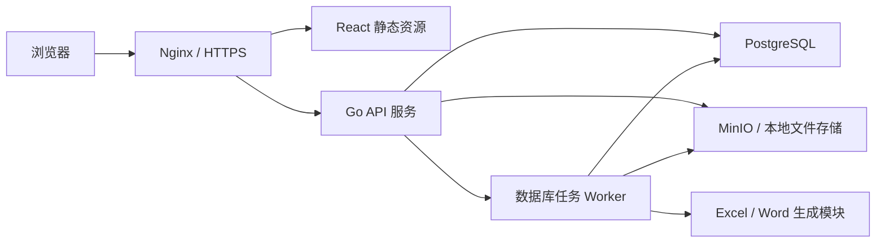
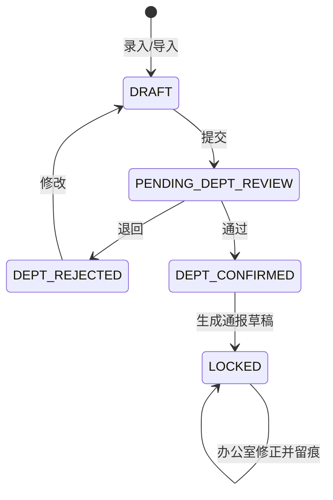
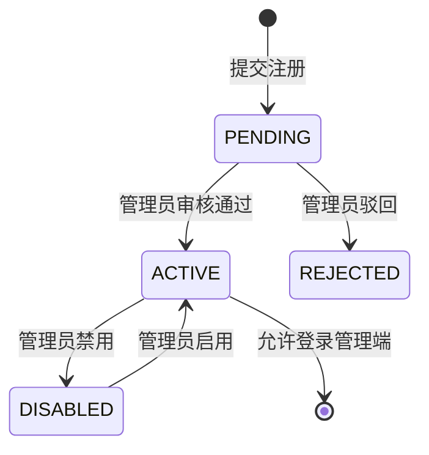

# 计算机学院日常管理系统技术方案

> 版本：v1.0  
> 日期：2026-07-11  
> 依据：《PRD-计算机学院日常管理系统》  
> 目标部署：Linux 云服务器或校内服务器

## 1. 方案结论

### 1.1 推荐技术栈

| 层次 | 技术选型 | 说明 |
| --- | --- | --- |
| Web 前端 | React 19、TypeScript、Vite、Ant Design 5 | 管理后台生态成熟，适合复杂表格、表单和权限页面 |
| 前端状态 | TanStack Query、Zustand、React Router | 服务端状态、少量全局状态和路由职责分离 |
| 后端 | Go 1.25+、Gin、GORM 或 sqlc | 推荐 Gin + GORM 快速交付；复杂统计 SQL 可直接编写 |
| API | RESTful API、OpenAPI 3.1 | 易开发、易联调、便于生成 TS 类型和接口文档 |
| 数据库 | PostgreSQL 16+ | 事务、约束、JSONB、窗口函数和复杂统计能力较强 |
| 缓存/任务 | MVP 可不部署 Redis；异步任务先用数据库任务表 | 降低运维复杂度；任务量增加后再引入 Redis/Asynq |
| 文件存储 | MinIO（推荐）或服务器本地目录 | 对象存储接口统一；校内单机也可部署 MinIO |
| Excel | excelize | Go 原生、适合模板、导入校验和导出 |
| Word | docx 模板占位符 + OOXML 处理 | MVP 使用固定版式模板；必要时封装文档生成模块 |
| 认证 | 内部账号密码、JWT 短令牌 + HttpOnly Refresh Cookie | 支持禁用、续期和会话撤销 |
| 部署 | Docker Compose、Nginx、HTTPS | 单机可完整部署，未来可迁移到 Kubernetes |
| 可观测性 | slog/zap、Prometheus 指标、健康检查 | 日志使用 JSON，关键操作另写审计表 |

### 1.2 架构选择

推荐“模块化单体”，不在 MVP 阶段拆微服务。系统账号量、并发量和数据规模都不需要微服务，业务难点主要在权限、审核状态、文件生成与历史追溯。模块化单体能保证一个事务内完成“数据修正—版本记录—状态变化—审计日志”，部署和备份也更简单。

备选方案：

1. Go 模块化单体（推荐）：开发、部署、事务和运维成本最低。
2. Go API + Python 文档服务：只有在 Word 模板复杂到 Go 库难以处理时采用，会增加服务治理成本。
3. 全 TypeScript：前后端类型共享更直接，但既然团队已选择 Go，且本系统强调稳定批处理和部署简洁，不作为首选。

## 2. 总体架构



后端按领域划分模块，但以一个 API 进程和一个可独立启动的 Worker 进程交付。两者复用同一代码仓库和领域服务。文件解析、统计快照、Word/Excel 生成放入任务队列，避免阻塞 HTTP 请求。

建议仓库结构：

```text
four-check-management-system/
├── web/                         # React 前端
├── server/
│   ├── cmd/api/                 # HTTP 服务入口
│   ├── cmd/worker/              # 异步任务入口
│   ├── internal/
│   │   ├── auth/                # 认证、会话
│   │   ├── iam/                 # 用户、角色、权限
│   │   ├── organization/        # 部门、组织角色
│   │   ├── academic/            # 学生、班级、课程、周次
│   │   ├── inspection/          # 检查记录和审核
│   │   ├── importjob/           # Excel 导入
│   │   ├── report/              # 通报、版本、快照
│   │   ├── template/            # 模板管理
│   │   ├── archive/             # 文件和归档
│   │   ├── audit/               # 审计日志
│   │   └── platform/            # DB、存储、配置、日志
│   ├── migrations/
│   └── openapi/
├── deploy/                      # Compose、Nginx、备份脚本
└── docs/
```

## 3. 领域划分与核心数据流

### 3.1 领域模块

| 模块 | 主要职责 |
| --- | --- |
| IAM | 注册审核、登录、用户状态、角色、授权、有效权限解释 |
| 组织 | 部门、组织角色、部门与检查类型映射 |
| 教务基础数据 | 学生、班级、教职工、宿舍、教室、课程、学期周次 |
| 检查业务 | 七类检查统一流程、明细扩展字段、部门提交和审核 |
| 导入 | 模板下载、文件上传、解析、校验预览、提交和回滚 |
| 统计 | 实时统计、通报统计、处分规则匹配 |
| 通报 | 草稿、审核、退回、通报内修正、定稿、更正、发布、归档 |
| 文件与模板 | Word/Excel 模板、生成物、原始文件、下载鉴权 |
| 审计 | 关键操作、字段变化、状态流转和权限变化留痕 |

### 3.2 主流程



通报状态：`NOT_GENERATED → DRAFT → PENDING_REVIEW → REJECTED → DRAFT → FINALIZED → PUBLISHED → ARCHIVED`。`FINALIZED` 后不可退回或原位修改；修正时创建关联原通报的 `CORRECTION` 新版本。

所有状态迁移必须由领域服务校验“当前状态 + 动作权限 + 数据范围”，禁止 Controller 直接更新状态字段。

## 4. 数据库设计

### 4.1 通用约定

- 主键使用 UUIDv7，跨环境导入不冲突且大致按时间有序。
- 时间字段统一存 `timestamptz`，API 返回 ISO 8601；业务日期使用 `date`。
- 核心业务表含 `created_at`、`created_by`、`updated_at`、`updated_by`、`version`。
- 可维护基础数据采用 `deleted_at` 软删除或 `enabled` 禁用；定稿快照禁止删除。
- 乐观锁使用 `version`，更新语句必须携带客户端读取到的版本号。
- 枚举优先使用 `varchar + CHECK` 或稳定代码表，避免 PostgreSQL ENUM 难迁移。
- 身份证号、电话等敏感字段应用层加密；另存不可逆 hash 用于唯一性判断和精确检索。

### 4.2 IAM 与组织表

#### users

| 字段 | 类型 | 约束/说明 |
| --- | --- | --- |
| id | uuid | PK |
| student_no | varchar(32) | UNIQUE，登录名 |
| name | varchar(64) | 非空 |
| password_hash | varchar(255) | Argon2id 或 bcrypt |
| status | varchar(24) | PENDING/ACTIVE/DISABLED/REJECTED |
| primary_department_id | uuid | FK departments |
| approved_by/approved_at | uuid/timestamptz | 注册审核 |
| last_login_at | timestamptz | 可空 |

其他 IAM 表：

- `departments(id, code, name, enabled)`
- `system_roles(id, code, name, is_super_admin)`
- `organization_roles(id, code, name)`
- `permissions(id, code, resource, action)`，如 `inspection.submit`、`report.finalize`
- `role_permissions(role_id, permission_id)`
- `user_system_roles(user_id, role_id)`
- `user_org_roles(user_id, department_id, org_role_id, start_at, end_at)`
- `inspection_types(id, code, name, extension_kind, enabled)`
- `department_inspection_scopes(department_id, inspection_type_id, can_enter, can_view, can_review, can_export)`
- `delegated_grants(id, subject_type, subject_id, permission_code, semester_id, week_id, inspection_type_id, class_id, grade, valid_from, valid_to)`
- `user_permission_rules(id, user_id, effect, permission_code, scope_json, reason)`，仅用于少量 ALLOW/DENY 特批；DENY 优先。
- `sessions(id, user_id, refresh_token_hash, expires_at, revoked_at, ip, user_agent)`

`scope_json` 仅用于权限范围这种稀疏、可扩展配置，不承载核心业务关系。常用范围仍用独立列，以便建索引和做外键校验。

### 4.3 基础数据表

- `academic_years(id, name, start_date, end_date)`
- `semesters(id, academic_year_id, code, name, start_date, end_date, status)`
- `semester_weeks(id, semester_id, week_no, start_date, end_date, enabled)`；唯一键 `(semester_id, week_no)`，日期范围不得交叉。
- `system_settings(key, value_json, updated_by)`；临时工作周次覆盖存配置并记录审计。
- `faculties(id, code, name)`、`majors(id, faculty_id, code, name)`
- `staff(id, employee_no, name, gender, phone_ciphertext, faculty_id, enabled)`
- `classes(id, code, name, grade, faculty_id, major_id, head_teacher_id, expected_size, enabled)`
- `dormitories(id, campus_area, building_no, room_no, enabled)`；唯一键 `(campus_area, building_no, room_no)`
- `students(id, student_no, name, id_card_ciphertext, id_card_hash, gender, phone_ciphertext, grade, faculty_id, major_id, class_id, dormitory_id, status)`
- `class_enrollments(id, student_id, class_id, start_date, end_date)`，保留转班历史。
- `courses(id, code, name, teacher_id, enabled)`
- `course_schedules(id, course_id, semester_id, class_id, classroom_id, weekday, start_section, end_section, valid_from, valid_to)`
- `classrooms(id, building, room_no, floor, enabled)`
- `dictionary_types`、`dictionary_items` 只承载可配置展示项；部门、角色、检查类型等有业务关系的数据不得仅作为字典项。

### 4.4 检查业务表

PRD 的“统一主表 + 类型扩展表”适合本系统。主表保存所有检查共有的身份、时间、流程与审计字段；扩展表保存类型专属字段。不要将全部专属字段塞入主表，也不要只存 JSONB，否则约束、查询和统计会变弱。

#### inspection_records

| 字段 | 类型 | 说明 |
| --- | --- | --- |
| id | uuid | PK |
| inspection_type_id | uuid | FK |
| semester_id/week_id | uuid | 明确所属学期周次 |
| department_id | uuid | 数据提供部门快照 |
| student_id | uuid | 可空，例如宿舍整体优秀记录 |
| student_no_snapshot/name_snapshot | varchar | 防止基础数据变化影响历史展示 |
| class_id | uuid | 可空 |
| class_name_snapshot/grade_snapshot | varchar | 历史快照 |
| occurred_at | timestamptz | 发生/检查时间 |
| violation_count | numeric(10,2) | 默认 1 |
| remark | text | 备注 |
| source | varchar(24) | MANUAL/EXCEL/REPORT_CORRECTION/MIGRATION |
| status | varchar(32) | 检查记录状态 |
| submission_id | uuid | FK department_submissions |
| import_batch_id | uuid | 可空 |
| locked_by_report_id | uuid | 草稿引用后锁定 |
| row_version | int | 乐观锁 |

扩展表均以 `record_id` 为 PK/FK：

- `attendance_details(record_id, course_id, absence_hours, teaching_class_id, classroom_id)`
- `morning_exercise_details(record_id, absence_count)`
- `dorm_hygiene_details(record_id, dormitory_id, reason_code, responsible_person, is_excellent, is_unqualified, building_scope, floor_unit)`
- `late_return_details(record_id, dormitory_id, late_at)`；多人晚归拆为多条学生记录，便于统计。
- `classroom_hygiene_details(record_id, classroom_id, responsible_area, responsible_person, reason_code, violation_description)`

到课率和无机课堂可共用 `attendance_details`，但保留不同 `inspection_type_id`。统计结果（累计旷课、到课率等）不写回明细。

#### 部门提交与审核

- `department_submissions(id, semester_id, week_id, department_id, inspection_type_id, status, record_count, submitted_by, submitted_at, reviewed_by, reviewed_at, review_comment, version)`
- 唯一键 `(week_id, department_id, inspection_type_id, revision_no)`；退回修改可保留同一提交并记录状态历史，重大重提可递增 revision。
- `workflow_events(id, aggregate_type, aggregate_id, from_status, to_status, action, comment, actor_id, occurred_at)`

部门汇总状态不重复手工维护，优先由提交状态映射；如为性能缓存，应由事务内统一更新并可重建。

### 4.5 Excel 导入表

- `import_batches(id, inspection_type_id, semester_id, week_id, department_id, original_file_id, status, total_rows, valid_rows, invalid_rows, imported_rows, created_by, committed_at, rolled_back_at)`
- `import_rows(id, batch_id, row_no, raw_data_json, normalized_data_json, validation_status, errors_json, record_id)`

导入分两阶段：上传解析只写 `import_batches/import_rows`；用户确认后，在单个数据库事务或可恢复的分批事务中写业务表。回滚只允许未被提交审核、未被通报锁定的批次；否则必须走业务撤销/更正流程。

### 4.6 通报、版本和快照表

- `reports(id, report_no, semester_id, week_id, title, report_kind, parent_report_id, status, created_by, finalized_by, finalized_at, published_by, published_at, version)`
- `report_inspection_types(report_id, inspection_type_id)`
- `report_versions(id, report_id, version_no, content_json, template_version_id, change_summary, created_by, created_at)`
- `report_record_refs(report_version_id, inspection_record_id, record_version, included_data_json)`：草稿引用关系和当时数据副本。
- `report_stat_snapshots(id, report_id, report_version_id, inspection_type_id, object_type, object_id, object_name, metrics_json, generated_at)`
- `report_corrections(id, report_id, record_id, before_json, after_json, reason, corrected_by, corrected_at)`
- `report_reviews(id, report_id, report_version_id, action, comment, actor_id, created_at)`
- `report_files(id, report_id, report_version_id, file_id, purpose, format, is_final)`

`metrics_json` 适合存不同检查类型差异较大的指标，但公共检索维度必须独立成列。定稿事务应：校验状态和权限 → 冻结当前版本 → 生成/固化统计快照 → 创建文件生成任务 → 将通报置为 `FINALIZING`；所有文件成功且校验通过后才变为 `FINALIZED`。失败则保留可重试状态，不能出现“已定稿但文件缺失”。

### 4.7 文件、模板、规则和审计

- `files(id, storage_provider, bucket, object_key, original_name, content_type, size_bytes, sha256, created_by, created_at, retention_type)`
- `templates(id, code, name, type, inspection_type_id, version_no, file_id, config_json, status, effective_from, effective_to)`
- `discipline_rules(id, rule_type, inspection_type_id, lower_bound, upper_bound, suggestion_code, semester_id, enabled)`；同一生效范围阈值不得重叠。
- `audit_logs(id, actor_id, action, resource_type, resource_id, before_json, after_json, reason, request_id, ip, user_agent, created_at)`
- `async_jobs(id, type, payload_json, status, attempts, max_attempts, next_run_at, locked_at, locked_by, result_json, error_message)`

### 4.8 关键索引

- `inspection_records(week_id, inspection_type_id, status)`
- `inspection_records(student_id, occurred_at DESC)`
- `inspection_records(class_id, week_id, inspection_type_id)`
- `department_submissions(week_id, department_id, inspection_type_id, status)`
- `reports(semester_id, week_id, status)`
- `report_stat_snapshots(report_id, inspection_type_id, object_type)`
- `audit_logs(resource_type, resource_id, created_at DESC)`
- `import_rows(batch_id, validation_status)`
- 对未删除数据的唯一性要求使用 partial unique index。

## 5. 权限设计

### 5.1 模型

采用 RBAC + ABAC：RBAC 决定“可执行什么动作”，ABAC 决定“可对哪些数据执行”。最终结果综合：

```text
系统角色权限
∪ 组织角色权限
∪ 部门-检查类型映射权限
∪ 指定管理员补充授权
∪ 用户单独允许
− 用户单独拒绝
```

数据范围再与学期、周次、检查类型、部门、班级、年级进行交集计算。超级管理员是唯一全局绕过者，但其操作仍记录审计。

### 5.2 鉴权落点

1. 前端菜单和按钮按权限隐藏，仅改善体验，不作为安全边界。
2. API 中间件验证身份、账号状态和基础 permission code。
3. Application/Domain Service 校验资源状态和数据范围。
4. Repository 将数据范围编译为 SQL 条件，禁止先查全量再在内存过滤。
5. 文件下载根据文件关联的通报/导入批次重新鉴权，禁止公开 object key。

提供 `GET /api/v1/users/{id}/effective-permissions`，返回权限、范围和每项来源；管理员页面可解释“为什么此用户拥有该权限”。权限变更后递增用户 `permission_version`，令牌携带的旧版本失效或触发重新加载。

## 6. 后端设计

### 6.1 分层

- Handler：HTTP 参数、响应和错误码转换。
- Application Service：用例编排、事务边界和权限调用。
- Domain：实体、状态机、校验规则、统计规则接口。
- Repository：PostgreSQL 数据访问和范围过滤。
- Infrastructure：对象存储、Excel/Word、密码、任务、日志。

禁止 Handler 直接操作 ORM；禁止把权限和状态校验散落在前端。

### 6.2 API 规范

- 前缀 `/api/v1`，JSON 字段 camelCase，数据库字段 snake_case。
- 列表统一：`page`、`pageSize`、`sort`、结构化筛选参数；返回 `items,total,page,pageSize`。
- 错误统一：`code,message,details,requestId`，字段错误在 `details.fields`。
- 创建返回 201；异步任务返回 202 和 `jobId`；乐观锁冲突返回 409；无权限返回 403。
- 写操作支持 `Idempotency-Key`，尤其是导入确认、定稿和文件生成。
- OpenAPI 作为接口契约，前端通过生成器生成类型与 API Client。

关键 API 分组：

```text
POST   /auth/register | /auth/login | /auth/refresh | /auth/logout
GET    /users/{id}/effective-permissions
GET    /semesters/{id}/weeks/current
GET    /inspection-types/available
GET    /inspection-records
POST   /inspection-records
PATCH  /inspection-records/{id}
POST   /department-submissions/{id}/submit
POST   /department-submissions/{id}/approve
POST   /department-submissions/{id}/reject
POST   /imports
GET    /imports/{id}/preview
POST   /imports/{id}/commit
POST   /imports/{id}/rollback
GET    /reports/readiness?weekId=...
POST   /reports
POST   /reports/{id}/submit-review
POST   /reports/{id}/approve
POST   /reports/{id}/reject
POST   /reports/{id}/corrections
POST   /reports/{id}/finalize
POST   /reports/{id}/correction-versions
GET    /files/{id}/download
GET    /jobs/{id}
```

### 6.3 校验策略

- 请求结构校验：必填、格式、长度、枚举。
- 引用校验：学生、班级、宿舍、课程等存在且启用。
- 一致性校验：学号与姓名匹配、学生与班级/宿舍匹配、日期属于所选周次。
- 业务校验：对应部门有该检查类型录入权、记录可编辑、阈值合法。
- 重复校验：按检查类型配置业务唯一键。例如晚归可用“学生 + 晚归时间”，旷课可用“学生 + 课程 + 日期 + 节次”。

导入校验结果必须给出行号、字段、错误码、中文说明和建议值。允许“仅导入正确行”时，界面需明确错误行未导入，且批次保留完整结果。

### 6.4 并发与事务

- 审核、锁定、定稿采用行锁或条件更新，防止两人同时操作。
- 通报生成记录所引用的 `record_version`；办公室修正必须检查版本未变化。
- 文件生成采用可重试任务，object key 使用确定性路径并以 SHA-256 校验，做到幂等。
- 统计快照和引用关系在同一数据库事务中生成；大文件渲染在事务外执行。

## 7. 前端设计

### 7.1 工程方案

- React + TypeScript + Vite。
- Ant Design 的 `Form/Table/Upload/Steps/Result/Descriptions`；复杂查询表格可用 Ant Design ProComponents 的 `ProTable`。
- TanStack Query 管理请求缓存、分页、失效和异步任务轮询。
- Zustand 仅保存当前用户、布局偏好等少量客户端状态。
- React Router 负责路由；权限路由由后端返回的有效权限生成。
- React Hook Form 可不引入，优先统一 Ant Design Form，避免两套表单状态。
- dayjs 处理日期；decimal.js 仅在前端需要精确展示计算时使用，最终统计以后端为准。

建议目录：

```text
web/src/
├── app/                         # 应用装配，不承载业务页面
│   ├── providers/               # Auth、Query、主题等全局 Provider
│   └── router/                  # 路由表、ProtectedRoute、权限路由守卫
├── pages/                       # 路由级页面，只负责页面编排
│   ├── auth/                    # 登录、注册、注册结果
│   └── home/                    # 工作台/当前阶段占位页
├── features/                    # 可独立复用的业务用例和业务规则
│   └── auth/model/              # 登录注册校验等认证规则，不放页面和 HTTP 基础设施
├── entities/                    # 领域 UI 模型及实体级展示能力
│   └── user/model/              # User 类型；后续增加 Student、InspectionRecord 等
├── shared/                      # 不感知具体页面和业务流程的公共能力
│   ├── api/                     # httpClient、端点 Client；未来由 OpenAPI 生成类型
│   ├── layouts/                 # AuthLayout、管理端布局等通用布局
│   ├── components/              # 权限按钮、状态标签、审计时间线
│   ├── hooks/                   # 与业务无关的通用 Hook
│   ├── styles/                  # 全局样式、设计 Token
│   └── utils/                   # 无副作用通用工具
├── test/                        # 测试环境公共配置
└── main.tsx                     # 唯一浏览器入口
```

前端依赖方向固定为：`app → pages → features → entities → shared`。上层可以组合下层，下层不得反向引用上层；同层模块之间避免通过内部路径形成循环依赖。具体约束：

- `pages` 只承载路由级页面和页面编排，不定义通用 HTTP Client、领域公共类型或全局 Provider。
- `features` 按业务能力建目录，内部可再分 `api/model/ui/hooks`；只有被多个页面复用或构成完整业务动作的代码才进入 feature。
- `entities` 保存领域类型、实体查询/展示等跨 feature 复用能力，不依赖具体页面。
- `shared` 不得包含 `auth`、`report`、`inspection` 等业务流程状态；端点 Client 可位于 `shared/api`，但 HTTP 传输、Token 注入和统一错误只由 `httpClient` 处理。
- 全局 Provider、应用启动和路由守卫位于 `app`；可复用布局位于 `shared/layouts`，业务页面位于 `pages`。
- 禁止把页面、API、Context、领域类型和工具函数因同属一个业务名而全部堆入单个 `features/<name>` 目录。

### 7.2 页面与交互

前端信息架构以《原型页面模块功能梳理》为实现基线。较早的《原型设计说明》中 8 个画板仍可作为页面视觉和交互参考，但其中“导入校验”“部门审核”不再作为一级导航。技术实现不得因为后端存在独立的 import、workflow 模块，就把技术模块直接映射为一级菜单。

#### 7.2.1 一级导航

左侧固定导航严格使用以下 7 项，并由有效权限控制可见性和子菜单：

1. 工作台
2. 日常检查业务
3. 通报管理
4. 基础数据管理
5. 用户与权限管理
6. 系统配置
7. 历史归档

登录、注册、注册结果等属于进入管理端之前的公共认证页面，不出现在左侧一级导航中，但属于 MVP 必须实现的前端页面。

#### 7.2.2 路由与页面归属

| 一级导航 | 子页面/业务页面 | 说明 |
| --- | --- | --- |
| 工作台 | 角色化工作台 | 当前周、我的待办、本部门状态、全院通报进度按权限组合展示 |
| 日常检查业务 | 业务列表、到课率、无机课堂、教室卫生、早锻炼/早签、宿舍卫生、晚归、公共宿舍卫生 | 只展示当前用户有权访问的业务 |
| 通报管理 | 周通报列表、数据汇总与统计、通报草稿、通报审核、定稿与导出、更正版本 | 统计属于通报生成链路，不设置独立一级入口 |
| 基础数据管理 | 学生、班级、教职工/班主任、宿舍、教室、课程、学期周次 | 每类基础数据在本页面内完成导入、校验和修改记录查看 |
| 用户与权限管理 | 用户列表、注册申请审核、用户详情与权限、指定管理员配置 | 用户详情展示权限、范围及来源 |
| 系统配置 | 部门与业务映射、检查类型、字典、模板、处分规则、系统参数 | 与日常业务录入分离 |
| 历史归档 | 通报归档、统计快照、审核记录、归档文件 | 定稿快照与实时业务数据明确区分 |

学年配置以起始年份为输入，结束年份固定为起始年份 +1，服务端生成规范名称并校验年份跨度。学期编码只允许 `FIRST`（上学期）和 `SECOND`（下学期），服务端按所属学年生成完整名称；前端提供默认校历日期并允许管理员按实际安排调整。同一学年、同一学期编码依靠数据库唯一约束和服务端校验防止重复。

建议路由：

```text
/login
/register
/register/result
/account-disabled
/dashboard
/inspections
/inspections/:inspectionType
/reports
/reports/:reportId/summary
/reports/:reportId/draft
/reports/:reportId/review
/reports/:reportId/finalize
/reports/:reportId/corrections
/master-data/students | classes | staff | dormitories | classrooms | courses | weeks
/iam/users | registrations | delegated-admins
/settings/department-business | inspection-types | dictionaries | templates | discipline-rules | system
/archives
```

#### 7.2.3 登录、注册与账号状态

认证页面使用独立 `AuthLayout`，不加载管理端侧边栏。视觉风格沿用原型的深蓝主色和浅灰蓝背景，但保持表单简洁，避免做成营销首页。

**登录页 `/login`**

- 字段：学号、密码。
- 功能：密码显隐、登录、防重复提交、错误提示；MVP 不提供自助找回密码，由管理员重置。
- 登录成功后读取当前用户和有效权限，再跳转到原访问地址或工作台。
- 待审核、已禁用、已驳回账号不得进入管理端，分别展示明确状态和处理提示，不能只显示“登录失败”。
- 连续登录失败时展示通用错误和必要的限流提示，不能暴露账号是否存在。

**注册页 `/register`**

- 字段：学号、姓名、所属部门、角色申请类型、密码、确认密码。
- 所属部门和可申请组织角色由公开注册配置接口提供，不在前端写死。
- 实时校验学号格式、密码规则和两次密码一致性；最终唯一性和申请资格以后端校验为准。
- 提交成功进入注册结果页，不自动登录。

**注册结果页 `/register/result`**

- 展示申请已提交、当前状态为“待审核”、后续处理方式和返回登录入口。
- 结果页不得依赖只存在于内存中的表单数据；刷新后可通过一次性申请编号查看结果，或只展示不含敏感信息的通用成功提示。

**账号状态处理**



前端对 401、403 和账号状态错误统一处理：Access Token 过期时只尝试一次静默刷新；刷新失败回到登录页；账号被禁用或权限版本变化时清空本地会话并给出明确提示。

#### 7.2.4 导入与审核的正确交互位置

- Excel 导入不是一级页面。用户在某个检查业务详情或某个基础数据页面点击“批量导入”，以 Modal/Drawer 或该页面的子路由完成“下载模板 → 上传 → 解析 → 错误预览 → 确认导入 → 结果”。
- 部门审核不是一级页面。部门管理员在对应检查业务详情中切换“待审核”视图，查看提交批次和明细，执行整体通过或退回；普通成员在同一业务中查看草稿、退回和已确认状态。
- 通报审核仍属于“通报管理”内部的明确子页面，因为它是另一套独立于部门审核的状态流程。
- `importjob`、`inspection`、`workflow` 等后端模块只代表代码职责边界，不决定菜单层级。

#### 7.2.5 关键页面交互

- 工作台根据普通成员、部门管理员、办公室通报管理员、查看者等角色复用同一布局并组合不同卡片，不为每个角色复制一套实现。
- 日常检查业务先显示业务卡片/列表；进入业务详情后使用统一页面骨架，动态装载类型专属筛选项、表格列和表单。
- 数据汇总与统计的筛选条件固定在顶部，统计口径、数据截止时间和未完成部门风险显式展示。
- 通报详情用步骤条表达汇总、草稿、审核、定稿、发布、归档阶段，并展示版本列表、审核时间线、办公室修正对比和文件列表。
- 用户详情采用右侧 Drawer 或独立详情页，用“权限—范围—来源”表格解释有效权限，而非只显示角色名。
- 历史归档中的定稿数据明确标记“快照”，与实时数据分开展示。

检查类型差异采用配置驱动的字段元数据，但表单组件仍显式编码。不要让管理员在 MVP 任意配置数据库字段，否则校验、统计和模板都会过度复杂。

### 7.3 前端安全与可靠性

- Access Token 只放内存；Refresh Token 放 Secure、HttpOnly、SameSite Cookie。
- 所有写操作防重复提交；表单离开前提示未保存内容。
- 409 版本冲突展示“数据已被他人修改”，允许刷新后重新编辑。
- 敏感字段默认脱敏，查看明文需额外权限并记录审计。
- 大导出和通报生成显示任务进度，不保持长 HTTP 连接。

## 8. 文件、模板和归档设计

### 8.1 存储策略

所有环境统一部署或连接 MinIO，不实现本地目录存储分支。Bucket 永远私有、启用版本控制并关闭匿名访问；API 使用独立最小权限账号。对象路径示例：

```text
imports/{semester}/{week}/{batchId}/original.xlsx
templates/{type}/{templateId}/v{version}/template.docx
reports/{semester}/{week}/{reportId}/v{version}/draft.docx
reports/{semester}/{week}/{reportId}/v{version}/final.xlsx
```

数据库保存元数据、SHA-256、状态和业务关联，不保存大文件二进制。业务代码只依赖 `ObjectStorage`，但阶段 1 唯一基础设施实现为 MinIO。

### 8.2 模板方案

- Excel 导入模板：固定 machine-readable 字段编码，中文表头仅用于展示；模板内含填写说明、字典选项和示例行。
- Excel 导出：excelize 按模板填充，生成后重新打开校验 sheet、关键单元格和行数。
- Word：使用经过审核的 docx 模板，定义段落、循环表格和条件附件占位规则；模板发布后不可覆盖，只能创建新版本。
- 每个通报版本记录模板版本、数据引用和生成文件，以保证重现。

若真实历史 Word 模板包含复杂跨页表格、页眉页脚和域，需在开发前制作 3—5 份代表性“黄金样例”做兼容性验证。Go 方案无法稳定满足时，再将文档渲染实现替换为 Python/LibreOffice 服务，但 API 和任务协议保持不变。

## 9. 安全、隐私与审计

- HTTPS；校内服务器也使用学校证书或内部 CA。
- 密码采用 Argon2id；登录按账号和 IP 限速，连续失败锁定并记录。
- PostgreSQL、MinIO 不暴露公网端口；仅 Nginx 对外。
- 配置和密钥通过环境变量/secret 文件注入，不进入代码仓库。
- 身份证号、电话使用 AES-256-GCM 信封加密；页面默认脱敏，导出时也按权限控制。
- 防止 IDOR：任何按 ID 查询、下载、编辑都必须重新校验数据范围。
- 审计日志追加写，普通管理员不可修改；记录操作者、请求 ID、前后值、原因和时间。
- 稳定审计动作包括注册审核、账号创建/修改/启停/密码重置、组织与权限规则、校历、基础数据、字典以及文件上传成功/失败、读取和完整性异常。
- 审计脱敏禁止保存密码、密码哈希、Token、Cookie、MinIO 凭据、请求体、上传文件原文和完整身份证号。
- 定稿快照和文件采用数据库权限、应用状态机和对象存储保留策略三层保护。
- 数据库每日全量备份，WAL/增量按部署条件启用；MinIO 每日备份到另一磁盘或另一存储位置。
- 建议 RPO 24 小时、RTO 4 小时；正式上线前至少完成一次恢复演练。
- PostgreSQL dump、MinIO 对象副本和清单必须使用同一备份批次标识；恢复时先写入空数据库与空 Bucket，再抽样重算 SHA-256 对比 `files.sha256`。MinIO 当前对象镜像不能代替版本历史复制或卷快照。

## 10. 性能和容量

按学院内部约 100—500 用户、峰值 50 并发、每学期数万条明细设计，单机配置建议：

- 4 vCPU、8 GB 内存、100 GB SSD 起步。
- PostgreSQL 2—3 GB 内存预算，Go API 512 MB—1 GB，Worker 1 GB，MinIO 按文件量规划。
- 列表强制分页，默认 20/页、最大 200/页；大导出异步生成。
- 1 万条以内常规筛选依靠组合索引保证 2 秒目标。
- 统计查询先用 SQL 聚合；出现明显慢查询后再增加物化视图或统计缓存，不提前引入复杂 OLAP。

## 11. 部署与运维

Docker Compose 服务包括：`nginx`、`web`（也可由 Nginx直接托管）、`api`、`worker`、`postgres`、`minio`。开发、测试、生产使用相同镜像，通过配置区分。

发布流程：

1. CI 执行 Go/React 单元测试、lint、构建和依赖漏洞扫描。
2. 生成带 Git commit 标识的不可变镜像。
3. 备份数据库，执行向前兼容 migration。
4. 滚动或短暂停机部署 API/Worker/Web。
5. 执行 `/health/live`、`/health/ready` 和核心冒烟测试。

数据库迁移使用 golang-migrate/Goose，每次迁移有明确回滚策略。结构性破坏变更使用“扩展—迁移数据—切换—清理”方式，避免新旧版本不兼容。

## 12. 测试方案

| 层次 | 重点 |
| --- | --- |
| Go 单元测试 | 状态机、权限合并、重复校验、周次匹配、统计规则 |
| Repository 集成测试 | PostgreSQL 约束、事务、并发审核和范围 SQL |
| API 契约测试 | OpenAPI、错误码、分页、幂等、鉴权 |
| 前端组件测试 | 动态表单、权限按钮、导入错误表、版本冲突 |
| E2E | 注册审核、录入、导入、部门审核、通报定稿、归档下载 |
| 黄金文件测试 | Word/Excel 内容、行数、sheet、关键单元格、模板版本 |
| 安全测试 | 越权、IDOR、文件下载、敏感字段、登录限速 |
| 恢复测试 | PostgreSQL + 文件存储联合备份恢复 |

至少准备七类检查各一组正常、边界、重复和错误数据。通报定稿 E2E 必须验证：后续修改基础数据不会改变历史快照；定稿不可撤回；更正生成新版本；每次动作都有审计记录。

## 13. 实施阶段建议

### 阶段 0：技术验证（1—2 周）

阶段 0 不是要求业务方自行完成技术设计，而是由业务方提供真实规则和代表性材料，由设计/开发方形成技术产物，再交由业务方回归验证。具体责任如下。

#### 业务方需要提供的材料

| 材料 | 最低建议数量 | 用途 | 可否脱敏 |
| --- | --- | --- | --- |
| 现有 Word 通报草稿和定稿 | 2—3 组，至少包含一份版式最复杂的文件 | 验证 Go 生成 Word 的页眉页脚、分页、表格、附件和 WPS/Office 兼容性 | 可以，必须保留排版结构 |
| 现有 Excel 录入、统计或通报附件 | 2—3 组；若七类业务格式差异明显，建议每类一份 | 提取字段、格式、公式、Sheet、合并单元格和打印设置 | 可以，必须保留表头、公式和单元格结构 |
| 七类检查业务的现行填写说明或口头规则 | 每类一份规则说明 | 判断必填项、字段含义、数据来源和审核口径 | 不涉及个人数据 |
| 典型正确数据和典型错误数据 | 每类各 5—10 条即可 | 设计导入校验、错误提示和重复判断测试 | 可以使用虚构数据 |
| 正式统计与处分口径 | 已执行的制度、规则表或负责人确认意见 | 确认累计方式、应到人数、阈值和通报展示规则 | 不涉及个人数据 |
| 角色和授权场景确认 | 部门、角色、业务映射及特殊授权规则 | 确认权限测试矩阵是否符合实际工作 | 不需要技术格式 |

如暂时无法一次提供全部材料，可先提供最常用的一套 Word 通报、一套 Excel 和七类业务基本规则，先完成第一轮验证；缺少的格式在后续补测。但正式上线前必须覆盖所有实际使用的文件类型。

#### 设计/开发方负责生成的产物

| 产物 | 具体内容 |
| --- | --- |
| 文件兼容性 PoC | Go 读取和生成 Excel/Word 的验证程序、生成文件、兼容性测试记录及无法支持的版式清单 |
| 七类标准字段表 | 中文名称、内部编码、类型、长度、必填性、来源、默认值、枚举、示例、数据库映射、通报用途 |
| 七类标准 Excel 模板 | 模板说明、下拉选项、示例行、格式限制和模板版本号 |
| 校验规则清单 | 必填、格式、引用一致性、日期周次、数值范围和跨字段校验 |
| 重复判定规则初稿 | 每类业务的候选业务唯一键、重复等级以及覆盖/忽略/报错策略 |
| 统计口径说明 | 指标公式、分子分母来源、统计范围、舍入规则、空数据规则和处分规则匹配 |
| 权限测试矩阵 | 典型用户 × 动作 × 部门 × 检查类型 × 学期/周次 × 预期允许或拒绝 |
| 权限原型和解释接口 | RBAC/数据范围计算代码、接口响应样例、越权测试结果和权限来源展示样例 |
| 阶段 0 结论报告 | 已验证项、失败项、风险、待业务确认项以及是否进入正式开发的建议 |

#### 业务方负责回归验证和确认的内容

| 验证项 | 业务方需要确认什么 |
| --- | --- |
| Word/Excel 生成文件 | 在实际使用的 Microsoft Office/WPS 环境打开，确认内容、版式、分页、打印效果和附件顺序 |
| 七类字段表和导入模板 | 字段是否完整、含义是否正确、填写方式是否符合实际工作习惯 |
| 校验与重复规则 | 正确数据不会误报、错误数据能够拦截、重复记录判定符合真实业务 |
| 统计和处分口径 | 公式、应到人数来源、累计周期、阈值和最终结果与人工核算一致 |
| 权限测试矩阵 | 各角色允许和禁止的动作、数据范围、指定管理员场景符合组织规则 |
| 权限解释页面 | 权限名称、范围和来源说明能被管理员理解，能够用于排查授权问题 |

回归验证应形成明确结果：`通过`、`有条件通过`或`不通过`。对不通过项记录样例、期望结果和实际结果，由设计/开发方修正后再次提交验证。业务方不需要审查 Go 代码或权限算法实现，只需要依据真实工作规则验证输入与结果。

#### 阶段 0 的完成条件

- 至少一套代表性 Word 和 Excel 文件通过目标 Office/WPS 环境验证。
- 七类标准字段、导入模板、校验规则和重复规则均已由业务方确认。
- 到课率、出勤率等核心统计口径已有明确数据来源，并与人工样例核算一致。
- 权限测试矩阵中的典型允许、拒绝和指定管理员场景全部通过。
- 权限解释接口能正确说明系统角色、组织角色、部门映射、指定授权和单独限制等来源。
- 所有未解决问题已记录负责人、处理方案和计划时间，不存在阻止正式开发的关键口径缺失。

### 阶段 1：基础平台（2—3 周）

- 登录注册、用户审核、组织角色、部门映射、有效权限。
- 基础数据、学期周次、字典、文件存储、审计框架。

### 阶段 2：检查与导入（3—4 周）

- 统一检查主表、七类扩展表、手工录入。
- Excel 模板、校验预览、确认导入、回滚。
- 部门提交、审核、退回和状态看板。
- 交付独立于 `/admin` 的普通用户应用外壳和角色化工作台，按有效 RBAC + ABAC 权限展示当前学年/学期/周次、临时周覆盖、我的待办、本部门业务状态和检查快捷入口。
- 阶段 2 工作台只展示检查与部门工作流信息；待生成通报、待通报审核、待定稿和完整全院通报进度属于阶段 3，不得提前伪实现。
- 阶段 2 完成必须通过[完整阶段 2 实施主计划与总体验收矩阵](./2026-08-30-phase-two-completion-implementation.md)；仅完成[工作流 A：通用导入框架 + 到课率第一增量](./2026-08-30-attendance-import-implementation.md)不代表阶段 2 完成。

### 阶段 3：统计与通报（3—4 周）

- 实时统计、草稿就绪检查、草稿版本。
- 办公室修正、审核退回、定稿快照、Word/Excel 文件。
- 发布、归档、更正版本和历史查询。

### 阶段 4：上线准备（1—2 周）

- 权限和越权测试、性能测试、备份恢复演练。
- 真实模板验收、数据初始化、用户培训和灰度运行。

## 14. 必须在开发前确认的业务项

1. 七类检查各自的标准 Excel 字段、必填项和唯一/重复判定键，以现有参考材料为基线形成系统标准模板。
2. 到课率、早锻炼等“应到人数”取检查时点班级实际在籍人数，并在通报定稿时固化统计快照。
3. 同一周、部门、检查类型是否允许多次提交，以及退回后是覆盖还是形成新修订号。
4. 通报草稿锁定粒度：整周、检查类型、提交批次还是单条记录。本方案推荐按被引用记录锁定。
5. 强制生成缺失部门通报所需权限和风险确认文本。
6. 办公室修正同步到提交信息后，部门端如何展示、是否需要只读确认。
7. Word/Excel 正式样式、空数据规则、文件命名和兼容软件范围。
8. 身份证号是否确属业务必需；若非必要，建议 MVP 不采集，以满足数据最小化原则。

## 15. 关键风险与决策

- **Word 兼容性是首要技术风险**：先做真实模板 PoC，再承诺全部版式。
- **出勤率的分母来源未定义**：需要课程排课/班级人数/签到应到表之一作为权威来源。
- **权限不宜做成任意表达式引擎**：MVP 使用固定维度和少量特批，保证可解释、可测试。
- **定稿不是普通状态更新**：必须同时固化引用数据、统计结果、模板版本和文件校验结果。
- **不建议 MVP 上微服务、Kubernetes、Elasticsearch**：它们不会解决当前核心业务风险，反而提高部署维护成本。

## 16. 验收基线

- 七类检查均可手工录入和通过新模板导入，1000 行预览和校验可用。
- 用户任何敏感操作均经过权限动作和数据范围双重校验。
- 用户详情可展示有效权限及其来源。
- 部门审核和通报状态只能按允许的状态迁移。
- 定稿保存统计快照、记录引用、模板版本、审核记录和文件，后续基础数据变化不影响历史通报。
- 文件下载不可通过猜测 ID 越权访问。
- 1 万条以内常规列表查询在目标服务器上 2 秒内返回。
- PostgreSQL 与文件存储可以从备份联合恢复，并能打开抽检的定稿文件。
