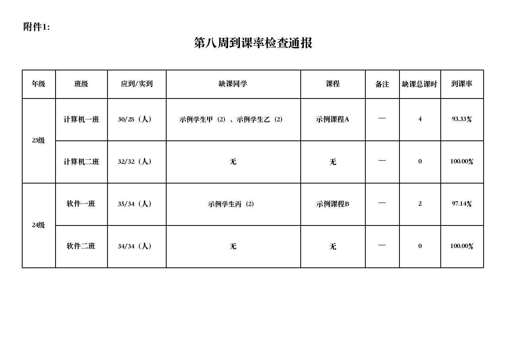
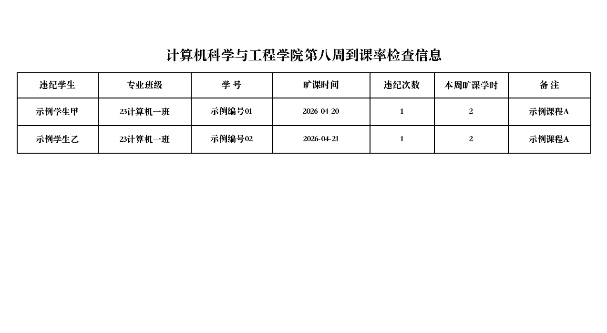

# 周通报 Word/Excel 样式预览与简化方案

> 2026-11-08 样式讨论稿。两项任务按“先学期适用年级与指标快照、后 Word/Excel 输出”实施；本文件所述生成链路尚未编码。下图使用虚构学生和示例数值，是按第八周定稿文件绘制的版式示意，不是实际系统生成结果，也不是对真实业务数据的验收。

## 先看样子

### Word：通报说明页

### Word：检查附件页（以到课率为例）

### Excel：一项检查一张工作表（以到课率为例）

[打开 Word 样稿](previews/weekly-report-2026-11-08/word-layout-preview.docx) · [打开 Excel 样稿](previews/weekly-report-2026-11-08/excel-layout-preview.xlsx)。Excel 样稿另有一张“晚归检查情况”工作表，用来展示组合文件的结构。页面图由相同文字和字段绘制；本机 LibreOffice 无法正确渲染中文，因此图不是 DOCX/XLSX 的逐像素截图，实际文件仍需在目标 Word/WPS、Excel/WPS 中核对。

## 样式按原文件走

- **Word：**沿用样例的白底黑字、宋体风格、居中标题和普通黑色表格。通报说明为纵向页；每项检查从新页开始，附件页横向排表。连续相同年级的“年级”单元格在同一页内纵向合并，班级仍逐行列出；跨页时从新页重新显示年级，不跨页合并。某类明细多时接着生成下一页，表头和列宽保持一致；一页内数据行尽量等高。没有卡片、彩色指标区、额外的版本横幅或独立汇总页。
- **Excel：**沿用样例的“一行合并标题、一行表头、下面逐行明细”。每项检查独立生成一个工作表；整份 Excel 将本次勾选的检查工作表放入同一个文件。没有额外首页、图表、仪表盘或跨表公式。
- 样例是**版式参照**。图里的“备注”替代了样例 Word 中当前报告快照不保证有值的“班主任”；Excel 的“本周旷课学时”替代样例“累计旷课学时”，避免把阶段四的学期累计写成本周数据。示例姓名、编号、人数和日期均为虚构。

## 八类检查放什么

共同原则：表中的明细取所选周通报版本已纳入的记录；数字取该版本已保存的指标。列名尽量沿用样例用语，确有现行字段差异时使用下面的列，不补造班主任、缺检、学期累计或历史处分信息。班级/全周数字只在相应版本快照存在且授权范围允许时显示。

| 检查 | Word 附件表格 / Excel 工作表主要列 | 可放在 Word 表格中的本周汇总 |
| --- | --- | --- |
| 到课率 | 年级、班级、应到/实到、缺课学生、课程、缺课学时、到课率；Excel 逐条列姓名、班级、学号、时间、课程、本周学时、备注 | 应到、实到、违纪人数、到课率 |
| 无机课堂 | 年级、班级、姓名、学号、日期、课程、节次、教室、次数、备注 | 违规次数、人次、人数 |
| 早锻炼/早签 | 年级、班级、应到/实到人次、缺勤学生、缺勤次数、出勤率；Excel 逐条列姓名、班级、学号、日期、次数、备注 | 应到人次、缺勤人次、出勤率 |
| 晚自习 | 年级、班级、姓名、学号、日期、节次、教室、缺勤次数、备注 | 缺勤次数、人次 |
| 宿舍卫生 | 日期、寝室号、情况、责任学生/班级、不合格原因、备注 | 个人宿舍卫生不合格次数 |
| 公共宿舍卫生 | 日期、责任寝室、情况、责任学生/班级、不合格原因、备注 | 宿舍公共卫生不合格次数 |
| 晚归 | 年级、日期、班级、寝室号、晚归学生、时间、备注 | 晚归次数、人次 |
| 教室卫生 | 年级、日期、班级、负责学生、教室、不合格情况、备注 | 教室卫生不合格次数 |

Word 的到课率/早签按样例采用**班级汇总表**；Excel 按样例采用**逐条记录表**。其他类型也按“附件标题＋普通表格”处理。若某项本版确认零记录，表下写“本周无已确认违纪记录”；来源尚未确认则明确写“来源未完成”，不能把两者混为一谈。历史版本没有指标快照时只显示该版本确有的记录，不用当前数据补算。

## 拼装和系统配置

1. **单项 Word/Excel：**选定周通报版本与一个检查类型，按上面样式生成。单项 Word 只有该检查附件页；单项 Excel 只有对应工作表。
2. **整份 Word：**生成时像 Excel 一样勾选八类检查中**本次要拼进去的类型**，可全选、部分选择并调整顺序。先放“通报说明”Word，再按勾选顺序放对应检查页；未勾选的类型不进入文件。每项从新页开始。
3. **整份 Excel：**使用同一套本次勾选结果与顺序，一个文件内每个勾选类型一张工作表；未勾选的类型不建表。
4. **系统配置：**有权人员在现有系统配置模块维护通报说明文案，以及 Word/Excel 生成页面的默认勾选类型和顺序。默认值只是打开生成页面时的初始选择；使用者本次可改，不改系统默认。八类检查的表格按已确定版式和字段生成，**不要求逐类上传或维护 Word 模板**。
5. 当前 `web/src/pages/admin/OrganizationConfigPage.tsx` 已管理检查类型及“参与通报”开关；输出默认勾选应作为系统配置中的独立设置，不能直接复用“参与通报”开关，否则会改变来源数据进入通报的业务语义。

## 实现时只保留必要的约束

- 生成时锁定用户选中的报告数据版本，Word/Excel 都只读该版本快照。文件生成与数据定稿分开；失败可以重试，文件不可用时不能出现下载按钮。
- 服务端检查生成和下载权限；文件留存版本、格式、所选类型与生成时间，方便找回对应附件。学号等个人信息仅在有权下载的内部文件出现。
- Excel 学号作为文本，用户文本不能变成公式。Word 每页列宽固定、同页行高一致，长内容换行或续页，不裁字。
- 先用现有样稿确认版式，再补齐其余检查类型的示例页和工作表；随后实现单项生成、Word/Excel 共用的勾选拼装、系统默认配置和真实 Office/WPS 验收。当前仅有样稿与方案，生成代码、配置页面和接口均未实现。

依据：[第八周定稿 Word](<../../参考文件/学生会办公室材料参考/2025-2026下word/定/第八周日常管理通报   （定  稿） .docx>)、[第八周定稿 Excel](<../../参考文件/学生会办公室材料参考/2025-2026下Excel/定/第八周日常管理通报  （定  稿)  .xlsx>)、[现有输出字段规格](2026-11-07-weekly-report-output-spec.md)、[指标规则](2026-11-07-weekly-report-indicator-statistics-plan.md)。
