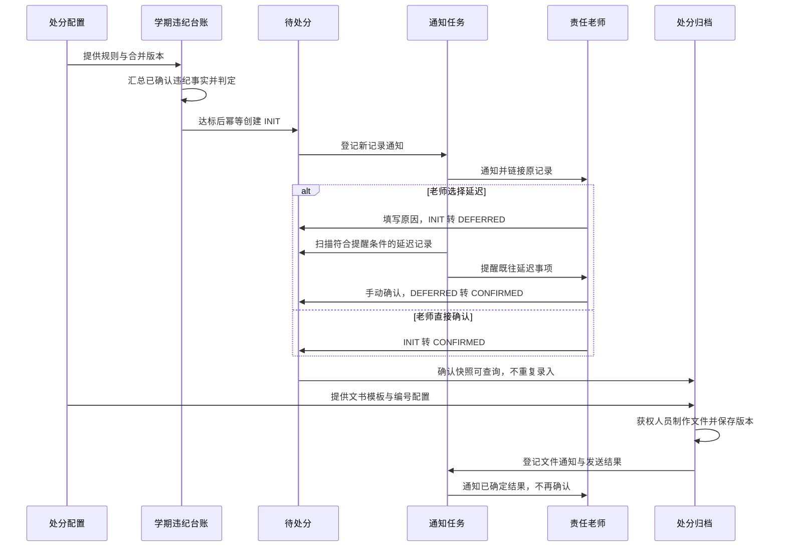

# 阶段四处分管理方案｜四模块与简化流程评审稿

2026-11-15 · 待批注版本。本文依据 V5.0 需求、最新会话确认、用户提供的流程图及当前项目源码。仅整理方案，不代表实现、部署或验收完成。

## 已确认的范围与实现顺序

目标：先让管理人员看清每个学生的学期违纪情况，再让有权限的老师处理达标记录，最后集中查阅已确定处分并制作文件。避免同一事项在多个待办、制作、台账页面重复维护。

四个子模块：处分配置、学期违纪台账、待处分、处分归档。实现顺序严格为：处分配置（处分规则配置、处分文件配置）→ 学期违纪台账 → 待处分 → 处分归档。导航可按使用顺序展示台账、待处分、归档、配置，导航顺序与实施优先级不必相同。

- 合并配置属于本期必做，不再仅保留入口或推迟实现。默认八项独立与具备合并能力并不冲突。
- 原需求“辅导员”统一对应项目现有“老师”组织角色，不新增另一套账号或角色。
- 确认后进入处分归档，即使文件尚未生成；归档页面不等于学期结束后的只读封存。
- 通知、文件生成、发送结果作为附属记录，不扩张处分主状态。
- 本期不重新建设八类检查和周通报，不做解除处分，不自动接入邮件、企业微信等外部服务。

## 当前项目可复用能力与缺口

本轮核对分支 feat-0.1-3。工作区正在进行老师适配，存在大量已有代码与文档改动，本次不覆盖。项目状态最新记录表明老师适配有隔离环境验证，但宿主 API 尚待加载最新校验；本轮未重新探测运行服务。

范围

 | 已具备基础

 | 阶段四需要补齐

 | 

检查与通报

 | 八类检查、部门确认修订、周通报及版本、文件输出

 | 学生学期累计、合并规则、处分判定与历史快照；不能叠加通报多个版本导致重复计数

 | 

老师与权限

 | TEACHER 单一组织角色、多部门关联、完整授权项与日期期限、授予时模板快照

 | 处分动作及其范围语义、责任老师匹配、无匹配和调岗处理；现有范围支持函数仅覆盖检查录入、管理、审核，不能宣称处分已接入

 | 

文件

 | 既有周通报即时生成下载，已有渲染、审计和文件基础设施

 | 处分文件持久版本、文号、作废更正与送达。不能直接照搬即时下载流程

 | 

提醒

 | 既有工作台可作为提醒入口；历史通知方案为草案

 | 新记录、延迟记录、临期提醒、任务幂等与失败重试；不视为已有可靠通知服务

 | 

源码核对依据：server/internal/permission/grant.go 中 OperationRange、AssignedGrant、SupportsOperationRange；server/internal/store/organization_assignments.go 中 AssignUserRole 与授权快照逻辑。结合 docs/project-status.md 及 2026-11-15 老师适配方案、整体修复方案。以上是源码与文档证据，不等于目标环境验收。

## 模块一：处分配置（优先级 1）

### 处分规则配置

- 按学期维护累计项目、计量单位、区间上下限、处分级别、适用年级和专业、依据条款、启停及版本。条款库作为本页子能力，不增加一级模块。
- 本期实现合并：拖拽将多个明细栏组成累计组，支持命名、拆分、移出、保存预览；同学期同一明细栏只能属于一个累计项或组合。
- 原始八栏始终保留可追溯明细；合并仅改变判定累计口径，不改写检查记录。台账同时能看到原始值与组合值，避免误以为原始栏被删除。
- 同单位项目可直接求和；学时与次数不能直接相加。建议首期禁止跨单位合并，若需折算须另行明确规则，不能自动假设换算系数。
- 保存前展示组内来源、计量方式、关联区间及受影响未完成记录。区间重叠、缺失或引用未就绪条款须明确报错或阻断相关出文。
- 合并、拆分及规则修改留存版本、人员、时间和前后差异。已确认处分使用确认快照；延迟记录与学期中途改组如何衔接见待批注项。
- 默认到课按学时，其余按各类确认口径计次；晚自习虽存学时但处分按次数；卫生仅不合格；无机课堂沿用处罚计次及学生节次去重。执行封顶记过。

### 处分文件配置

- 管理分类通报批评决定、合并告知书、个人处分决定三类模板，按处分类型和级别绑定，维护版本及启用状态。
- 配置正文、落款、学年学期、学生字段、累计事实、条款引用、附件字段、排序、分页、文件名及文号规则；文书数据来自冻结快照，模板不改变处分结果。
- 通报批评决定按栏或合并后口径出文；合并后的出文粒度、条款及事实表述需明确，不能只实现累计求和而留下模板断点。
- 告知书合为一个文件，每页两份；原始固定排序与不同落款保留。支持虚构数据预览与必填字段校验。
- 文号预览不占号，正式生成时按年份与文种分配；作废不复用。配置阶段完成样例验证，真实业务文件生成在归档阶段接入。
依赖：学期、检查类型、字典、组织权限、审计、现有渲染基础。完成条件：八栏配置、实际合并/拆分、版本、冲突拒绝、三类模板样例及权限检查均可验证，不能只交付静态配置页面。

## 模块二：学期违纪台账（优先级 2）

- 按学生一人一行汇总全学期，覆盖有查看权限的所有年级、专业、班级；支持学年学期与学生筛选、分页和导出。
- 展示八类原始累计、配置后的组合累计、建议处分及关联处理情况。未达标学生也展示；无违纪为零，来源未就绪或读取失败不得伪装成零。
- 累计建议读取部门已确认的有效来源修订，保留记录标识与修订用于去重；周通报作为关联追溯入口，不按通报文件或每版快照重复相加。
- 点击累计查看日期、检查结果、学时或计次、来源部门、确认信息；学生详情关联待处分及已确认处分。
- 规则变化或事实更正可重算并留痕；已确认处分快照不被实时台账覆盖。按学期重置新累计，历史学期可查询。
- 判定命中后向待处分提供候选；同一学生同一学期同一累计项避免创建重复有效待处理事项。不同累计项分别处理，不跨项只取最高级别。
依赖：已发布规则与合并版本、确认来源、学生名册及学年映射。完成条件：原始明细、组合值与判定可逐条对账；重复修订、零记录、晚自习、无机课堂去重及更正重算有回归证据。

## 模块三：待处分（优先级 3）

- 集中展示达标且未确定实施的事项，分“待确认”和“已延迟”筛选；学生聚合展开各项目，展示累计、规则、建议级别、责任老师和提醒。
- 有有效处分确认权限且在责任范围内的老师核对后确认或延迟；确认二次提示影响对象，延迟填写原因。不凭 TEACHER 角色名自动授权，也不让所有老师看到或处理所有学生。
- 新建记录通知责任老师；提醒扫描同时发现符合条件的既往延迟记录。提醒记录不等于新建处分记录，重复执行不重复创建案件或无限发送。
- 延迟记录可由老师手动确认，无需先“恢复”为新记录。通知入口打开原记录；有新累计或新建议级别时展示变化并保留历史。
- 显示截止时间、剩余时间和临期提示。原需求的自动确认与时限计法尚待批注，不把“超时”自动解释为同意。
- 确认写入处分结论、事实与规则快照及审计，原子地成为处分归档可查询记录。并发由先成功者生效，后提交明确提示已处理。
依赖：台账判定、现有老师与授权体系扩展、责任匹配、提醒任务。完成条件：创建→通知→确认、创建→延迟→提醒→手动确认均闭环；无老师匹配、撤权、到期、并发及任务重试均不能扩大权限或产生重复处分。

## 模块四：处分归档（优先级 4）

- 展示所有已确定处分，按学生、学期、年级、专业、班级、级别及累计项查询；一人多次或多项处分分别留存，支持导出。
- 详情展示确认人员、时间、方式、意见、事实快照、规则及合并版本、关联旧处分；归档是确认结果视图，不需要人为搬移或重复录入。
- 有出文权限者从记录发起“核对要素→选择模板与日期→预览生成”，数字、级别及依据只读。文书生成状态独立，失败可以重试，不能撤回已确定结论。
- 保存文件版本、模板版本、文号与生成日志；按责任关系发送给老师并记录送达，此步不再要求确认。
- 作废、更正保留旧文件与文号，不能覆盖历史结论；学期封存后只读，异议走更正记录。本期不做解除处分。
依赖：已确认记录、处分文件配置、文件存储、文号与通知能力。完成条件：确认即能查到，无文件时准确显示；并发不重号、失败可恢复、下载鉴权、模板排序与分页、历史版本一致性有真实验证。

## 主状态简化与用户流程图对应

页面名称

 | 建议代码

 | 含义与允许迁移

 | 

待确认

 | INIT

 | 达标创建；老师可确认进入 CONFIRMED，或延迟进入 DEFERRED

 | 

已延迟

 | DEFERRED

 | 对应图中 end；仍可提醒并手动进入 CONFIRMED，不是终态，不因提醒自动回 INIT

 | 

已确认

 | CONFIRMED

 | 进入处分归档；制作文件和发送不改变该主状态

 | 

状态代码为实现建议，业务含义按图。不再把待指派、待发送、已生成、已送达混入主状态：老师匹配异常、文件失败、通知失败分别展示附属标记。学期封存与更正另记事件和关系。撤案、确认后纠偏等异常如何表达仍需评审，不为简化而删除审计。

## 模块依赖与处理时序

构建依赖：规则配置支撑台账计算和待处分判定；文件配置支撑归档出文；老师授权及责任范围支撑待处分和归档访问；通知是待处分与归档共用能力，不新增独立业务模块。

图中主线对应警告及以上。原需求通报批评无需老师确认，其周名单由获权人员确定后进入归档；是否也统一经过 INIT、由谁触发 CONFIRMED，需本次批注明确。提醒周期与超时策略不在图中默认执行。

## 老师角色与权限衔接

沿用现有账号、TEACHER 组织角色、所属部门及实际授予时的权限快照。每个动作都重新校验有效日期、部门职责和所属关系；不混合不同来源的动作和范围形成越权组合。新增处分配置、台账查看/导出、处分确认/延迟、归档查看/导出、文件制作/更正等动作的具体名称待技术设计冻结。

关键缺口：有检查审核权限不等于已获处分确认权；现有查看权限不按操作范围自动收窄，也不能直接推断“负责哪些学生”。建议为处分确认明确责任范围语义并复用现有年级/专业/班级与学年阶段表达，通知解析同一责任关系。究竟使用独立班级责任映射，还是以新增处分确认授权中的范围直接解析责任老师，列为待批注；不先新增一套辅导员绑定页，也不静默复用检查审核授权。

同班多人可处理时只允许一份有效确认；未匹配老师显示“责任老师未配置”，不通知同专业所有老师。调岗或撤权后原链接不可继续确认，转交留痕。历史身份快照用于出文，当前权限用于读取与操作，两者分开。

## 请优先批注的问题

- 图中只画老师确认，原 V5.0 有超时自动确认。是否保留？未裁决前仅设计提醒，不默认自动处分。
- 确认期限采用工作日还是连续日历日？延迟提醒是否每周一次，是否重新计算期限？图中“发现既往延迟记录”已确认要支持，具体频率仍待定。
- 老师责任匹配采用处分确认授权范围，还是独立班级责任映射？查看范围与操作范围必须分别明确。
- 合并是否限定同单位？合并后多栏条款、事实句、分类决定与告知书按组还是原栏组织？建议按组判定并保留原栏事实，文书表达需明确。
- 学期中改组如何处理 INIT 与 DEFERRED？建议已确认冻结，未确认按明确生效版本重判，延迟旧组是否保持到学期末按原文待确认。
- 通报批评是否沿用无需老师确认、由获权人员确定名单的特例？批量确认如何提示完整影响范围？
- 同累计项已确认警告后达到更高级别，建议新建关联的升级处理记录，保留旧处分；已确认记过停止新增处分提醒。请确认升级粒度。
- 事实纠偏减少累计、误判撤案及已确认处分更正如何处理？不能直接解锁改写定稿或历史快照。
- 原文“生成后24小时未打印可撤销”缺少可验证的打印判据；文件作废与处分结论撤销应分开。初始条款缺失也需补齐后才能真实出文。

## 实施与验收边界

本稿先供批注。评审后按四模块顺序细化迁移、API、页面、模板初始化和测试。前端沿用 ProTable、TanStack Query 与单一权限侧边栏；后端沿用模块化单体和 PostgreSQL。通知任务建议复用技术方案的数据库任务方向，不为本期引入新队列或外部基础设施。

验收重点：真实 PostgreSQL 下合并互斥与版本、来源去重、确认并发和审计回滚；真实浏览器下不同老师范围、到期撤权、延迟后确认、归档联动及失败重试；真实文书字段、排序、分页、文号和快照一致性。模型/迁移、API、页面、模板/初始配置、真实环境、角色验收分别记录，不以 Demo 或当前老师适配测试替代阶段四验收。

当前交付仅本评审文档。已有 Demo 仍为历史交互示意，未实现本次合并配置与最新老师权限，也不作为本方案已落地的证据。

