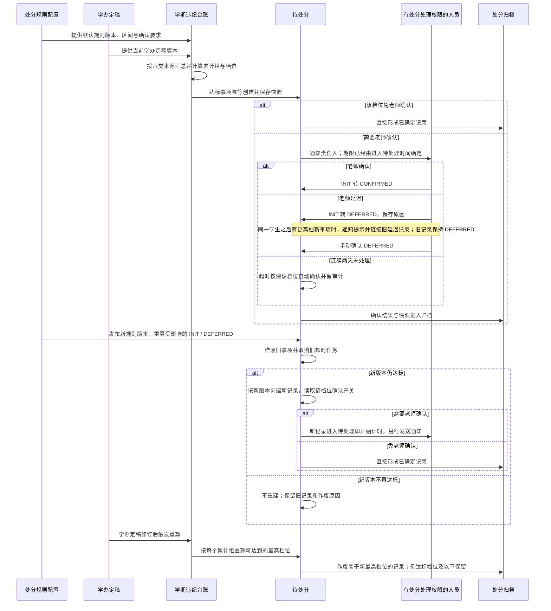

# 阶段四处分管理方案｜评论整合稿

2026-11-16 · 按已完成评论修订，供业务复核。本文梳理产品方案与页面交互，不代表代码实现、部署或验收完成。

## 一、范围与实施顺序

阶段四仍由四个模块构成：**处分配置、学期违纪台账、待处分、处分归档**。用户操作顺序是“看学期情况 → 处理达标事项 → 查已确定结果”；实施优先级仍为“处分配置 → 学期违纪台账 → 待处分 → 处分归档”。

处分配置内部保留“处分规则配置、处分文件配置”两个能力。本期先实现处分规则与合并配置；文书模板配置和真实文书生成暂缓，后续与文件制作能力一并交付。归档记录不依赖文书生成，因此本期确认的处分仍可进入处分归档。这样保留四模块和原实施顺序，不把模板编辑、文号、文件包、送达等后续能力塞进本期 MVP。

本期不重做八类日常检查、周通报与既有权限管理，不新增“辅导员”角色，不做解除处分，不接入邮件、企业微信等外部服务。需求中的“辅导员”对应项目现有“老师”组织角色；具体处分操作仍需新增对应动作权限并由服务端校验。

阶段四共用全局「消息中心」。建议先交付独立收件箱及组织、权限变更消息，再接入处分待确认、事项替换和结果通知。工作台和待处分页复用同一业务事项，处理权限与截止时间由处分服务校验。事件范围、投递依据和验收见[全局消息页与阶段四接入建议](2026-11-14-teacher-notification-proposal.md)。

### 处分管理的统一授权（已确认）

处分配置、学期违纪台账、待处分和处分归档共用一个「处分管理」权限组。部门模板和个人权限配置按业务流程依次展示「日常检查 → 周通报 → 处分管理」。参照日常检查和周通报，管理员先配置部门承担的功能及开放动作，再按角色设置默认模板；也可在个人授权中对指定账号单独配置动作、有效期和适用范围。模板授予时形成快照，后续调整沿用项目已有的授权变更流程。

| 页面 | 可配置动作 |
| --- | --- |
| 处分配置 | 查看规则、维护草稿、发布规则 |
| 学期违纪台账 | 查看台账、导出台账 |
| 待处分 | 查看待处分、处理待处分（确认、填写原因后延迟） |
| 处分归档 | 查看归档（含详情和追溯）、导出归档 |

学生会办公室和年级部为默认承担部门，可分别配置职责。年级部默认由老师在授权范围内处理待处分，其他委员默认关闭。办公室的委员、副部长、部长、分管主席和老师按模板分工参与，后续归档由办公室默认承担。各角色具体可执行的动作以保存的配置为准。超管沿用系统全权限语义。

后续新增归档或文书动作时，在同一权限组登记，并同步接入部门职责、角色模板、个人授权及服务端鉴权。新增动作默认关闭，管理员明确授予后生效。菜单、按钮和接口按有效动作授权判定，涉及责任范围的操作还须检查目标记录。禁止按部门名称、老师或学生身份等写死业务准入条件。

权限验收须覆盖模板授权、个人授权、未授权、范围外及授权到期；例如给学生单独授予指定班级的处理权后，可处理该班事项，跨班提交须被服务端拒绝。仅授予归档查看的账号可查详情，导出须另行授权。后续归档动作沿用这些验收条件。

## 二、模块一：处分配置

### 处分规则配置页

页面顶部显示“当前默认规则”及当前生效版本，旁边提供“新建版本”和“查看历史版本”。主体是一张按**累计组**展示的规则表，列出组名、组成的检查项、累计算法与单位、处分档位区间、对应依据条款、是否需要老师确认、更新时间和操作。选择一行后，在同页展开规则详情；“合并配置”进入独立配置面板。不要再拆成学期规则、区间维护、条款维护三个互不相干的入口。

**主要功能**

- **合并与拆分检查项。**从需求中的八类检查项中选择项目加入或移出累计组；支持拖放，也支持选择项目后点击“加入组 / 移出组”，并提供键盘操作方式。组内显示全部来源项目。一个检查项同一时刻只能属于一个有效累计组；原始违纪明细始终保留。
- **配置累计算法。**可以把不同单位项目合并，但必须明确单位换算和算法。例如“旷课学时 + 晚自习缺勤次数 × 2”。只允许选择项目、填写换算系数及加减运算；没有转换系数时不得跨单位相加，不支持脚本或任意表达式。公式结果和处分阈值均按合并后的组计算，组内事实仍可追溯至原始项目。
- **配置档位与依据。**针对累计组设置处分级别、累计区间和依据条款；用表格逐行关联档位区间与依据条款，在同一详情中维护。区间边界、重叠和空缺在保存前校验。升级按档位生成独立可追溯的处分记录，不覆盖之前档位的历史记录；沿用需求的记过封顶规则。
- **配置老师确认开关。**每个处分档位设置“需要老师确认”。通报批评的默认值为关闭，达标后直接形成已确定记录；其他档位默认开启，进入待处分由具有处理权限且范围匹配的人员确认。后续管理员可在新规则版本中调整该值。
- **预览并发布版本。**发布前预览公式计算、区间命中、组变动及受影响的未完成事项。发布新默认版本后，受影响的 INIT / DEFERRED 旧事项标为作废并保留历史，按新版本重算：仍达标则创建新的事项/记录并重新通知；不再达标则不重建。取消旧事项的超时自动确认任务；新记录进入待处理时重新开始连续两天时限。CONFIRMED 历史记录不因单纯规则发布而重算。
- **查看版本与影响。**历史版本只读，显示编辑人、时间、差异和生效点。新记录保存所依据的规则版本；旧 INIT / DEFERRED 作废后保留旧规则快照、作废原因和新旧记录关联，便于追溯。

### 处分文件配置（后续能力，本期不实现）

这一能力仍归属“处分配置”，但本期不增加模板配置页面，也不承诺生成、打印、文号、文件包或送达。后续做文件能力时，模板配置与真实出文一起设计和交付；“生成/打印”按评论中的业务语义合并为同一操作记录，不另造一个难以验证的物理打印状态。

## 三、模块二：学期违纪台账

### 学期违纪台账页

页面顶部选择学年、学期，并提供年级、专业、班级、姓名/学号筛选和导出入口。主体是一张学生汇总表，**只显示本学期存在违纪记录的学生**。表格固定学生及班级信息，按八类检查分组展示累计值，并单独展示合并组累计、待处分数量和已确定处分数量。合并组不能与原始八项混成一个“总计”，避免重复计数或误读。

点击学生行进入详情；详情把“本学期累计”和“违纪明细”合在同一视图，先展示八类累计及合并组算法，再可展开查看对应日期、检查项目、计次/学时、来源和定稿版本。页面不另开八类检查分页，也不在台账直接确认处分。

**主要功能**

- **查全院学生违纪情况。**只设置一个“违纪台账查看”权限；具备该权限即可查看所选学期全院有违纪记录的学生，不按老师的班级、专业或部门操作范围裁剪。列表不展示零违纪学生。
- **核对累计来源。**点击累计数可展开构成该数值的明细；合并项显示每个来源项目贡献值、转换系数和组内合计。无法取得来源或计算失败时显示明确异常，不能显示成零。
- **限定处分数据来源。**只有学办定稿版本进入处分累计、阈值判定和后续待处分。部门确认数据、通报草稿及未定稿修改仅作为追溯材料，不计入处分。页面标明当前使用的学办定稿版本及更新时间。
- **联动与导出。**点击待处分数量进入待处分并定位对应学生；点击已确定处分数量进入归档。台账负责核对和追溯，不重复放确认、延迟或文书操作。导出使用独立的“违纪台账导出”权限；只有同时具备查看和导出权限的用户才显示导出入口，服务端对导出请求重复校验两项权限。查看权限本身不附带导出权。
- **处理定稿修订。**学办定稿修改后，按同一学生、学期和累计组的新定稿重算可达到的最高档位；该次重算使用的适用规则版本单独记录。将不再达标的更高档位处分记录标记为“作废”，保留原记录、定稿版本、原因和审计；仍达标的该档及以下记录保持原状态，其他累计组或历史记录不受影响。例：新定稿仍达严重警告，作废记过并保留严重警告及以下；新定稿只达警告，作废记过和严重警告并保留警告及以下。此规则适用于 INIT、DEFERRED 和 CONFIRMED 记录；作废不物理删除，也不改写仍达标的低档历史。后续文书能力如已生成/发送，仅处理关联到被作废档位的文件，不纳入本期 MVP。

## 四、模块三：待处分

### 待处分页

页面顶部用状态筛选和数量显示“待确认、已延迟、临近截止”，默认进入待确认。下方为学期、年级、专业、班级、累计组、处分档位筛选。列表按学生聚合，展开后每个累计组/档位是一条独立事项，显示当前累计、命中规则、责任处理人、状态、通知时间、截止时间和操作。批量操作针对展开后的具体事项，不针对整名学生。

点击事项后在同一侧栏查看学生、累计公式、命中区间、学办定稿来源、历史处分和延迟原因；底部提供“确认处分”和“延迟处理”。查看与处理分别配置年级、专业及班级范围；已授予查看且未设范围时可查看全部待处分事项。显式查看范围决定列表、搜索与总数；可见记录中，仅处理范围内允许操作，其余标为只读。历史仅处理授权可查看自己可处理的事项。提交时服务端校验处分确认有效授权、责任范围和记录版本。超管拥有全范围审批权；年级部老师模板默认开启，其他角色通过模板或个人授权也可处理。

**主要功能**

- **生成待处理事项。**只有学办定稿数据达到已发布规则才创建事项。同一学生、累计组和处分档位幂等去重；规则版本、定稿版本、累计值和依据快照随事项保存。
- **通知责任处理人。**责任人取自处分确认有效授权及其范围，不新增班主任/辅导员绑定页。记录通知成功时间和连续日历日截止时间；列表同时显示准确截止日期、剩余时间和临期状态。
- **确认或延迟。**老师查看来源后确认，记录进入已确认并在归档可查；延迟时填写原因，原事项保留在已延迟列表，可再次打开确认。延迟不会复制事项，也不会自动确认。
- **两天超时自动确认。**保留需求中的连续日历日时限及超时自动确认。计时从记录进入待处理状态开始；到期时仅对仍待处理的记录按建议档位自动通过。已确认和已延迟的事项均退出超时自动确认队列。后台按状态和版本原子更新，记录系统执行时间、规则版本和来源快照。自动确认结果清晰标注为系统处理。节假日不顺延。
- **提醒既有延迟事项。**不做每周重复提醒；同一学生之后出现新的待处分事项（包括升档）时，在通知中明确提示其存在既往延迟记录，并链接原事项。升档时原 DEFERRED 记录及原因继续保留，不关闭、不改写、不并入新档事项；提醒本身不改变其状态。
- **按档位记录升级。**同一累计组达到更高档位时产生该档位的新事项/处分记录，低档已确认记录保留。达到记过后沿用需求封顶规则，不再创建更高档提醒。旧档延迟记录按上条保留并随新事项通知提示。
- **同步规则版本。**新版本发布时按配置模块的处理：废弃所有受影响的 INIT / DEFERRED 旧事项，取消其自动确认任务；按新版本重算并创建新的事项或免确认记录，重新通知。旧事项保留快照与作废原因；新事项拥有新记录标识和新的审批时限。已确认历史处分不因规则发布而变化。
- **支持免老师确认。**通报批评默认关闭“需要老师确认”，达标后直接进入已确定处分/归档；其他档位默认开启。该路径不进入待处分老师确认队列。

## 五、模块四：处分归档

### 处分归档页

页面是所有已确定处分的查询台账，处分确认或规则配置的免确认路径形成记录后即可出现，不要求文件已生成。顶部按学期、学生、年级、专业、班级、累计组和处分档位筛选；主体每条显示一项处分的学生、档位、累计组、确定方式（老师确认/系统自动）、确认人或系统执行时间、规则版本和状态。详情查看来源快照、依据、意见、关联的升级档位及审计记录。

本期只交付处分记录查询、详情、历史追溯及必要的列表导出，不做文书模板维护、生成/打印、文号、送达、通报批评文件包或更正文件流程。这些能力随“处分文件配置”后续一并设计；归档记录与文件状态不合并成同一个状态。

**主要功能**

- **查询确定结果。**筛选并查看全院已确定的处分记录；同一学生多档处分分别呈现，可按学生查看关联历史。未生成文件不影响归档查询。
- **查看形成依据。**详情展示学办定稿版本、违纪来源明细、累计公式结果、命中区间、规则/条款版本、处理方式及操作轨迹。新规则不能改写既有处分快照。
- **查看作废记录。**由定稿修订导致失去依据的记录标注作废，仍能查到原始记录和作废原因；其他既有档位处分保持原状。作废不等于物理删除。
- **导出当前结果。**按当前筛选条件导出已确定处分记录，使用归档导出动作权限并记录审计；导出不改变处分状态。

## 六、主状态与跨模块时序

处分主流程沿用流程图并简化为“待确认（INIT）→ 已确认（CONFIRMED）”及“待确认（INIT）→ 已延迟（DEFERRED）→ 已确认（CONFIRMED）”。记录进入待处理状态后连续两天未处理，系统按规则自动转为 CONFIRMED。规则设为免老师确认的档位直接形成 CONFIRMED。文件、通知发送和打印不扩展主状态。因学办定稿修订失去依据时，记录另标记作废并保留原始轨迹；它是纠偏结果，不是常规处理流转状态。

## 七、项目适配、依赖与验收边界

- **当前项目基础与缺口：**项目已有学生/学期、八类检查、学办定稿/周通报、TEACHER 组织角色、授权范围和审计基础；尚无处分规则、学期违纪计算、待处分状态流转和处分归档页面。现有授权范围函数覆盖检查相关动作，处分确认必须作为新动作接入服务端授权；不能把已有检查审核权限等同于处分确认权。既有周通报文件是即时输出，不能当作已具备处分文书版本、文号、生成与更正能力；提醒也不能假定已有可靠通知任务。
- **复用项目现有能力：**沿用学生、学期、检查类型、现有老师角色、权限授予、审计及文件基础设施。新增处分权限动作与范围需补进现有授权模型，不能仅依赖前端隐藏按钮。
- **依赖关系：**规则与合并配置 → 学办定稿来源的学期累计 → 待处分判断、通知与老师处理 → 已确定处分归档。文书模板与生成依赖规则版本、归档记录及文件存储，因本期暂缓，不阻塞本期归档查询。
- **本期验收重点：**单位转换与公式校验、合并组阈值、版本快照、来源去重、学办定稿修订后的作废留痕、连续日历日自动确认、老师权限范围、延迟提醒触发条件、升级档位独立记录及归档查询。真实文书模板、文号、打印、送达与文件作废不纳入本期验收。
- **页面交互原则：**沿用项目 Ant Design / ProTable，保持克制的事务后台视觉；突出累计值、临期事项和作废状态，颜色持续表达同一类含义，避免重复统计卡和装饰图表。台账宽表保留八项与合并组分组、固定学生列和局部横向滚动；分组表头与数据列关系明确，滚动区域有可访问名称并可键盘操作。窄屏以学生摘要和字段名清晰的来源详情呈现，不裁切整页、不缩小文字，也不在展开行中再嵌套复杂表格。待处分的选择粒度落到具体档位事项；全选范围、涉及人数与截止时间要明确。表单有常驻标签，错误贴近字段，保存失败保留输入；抽屉关闭可返回原列表状态。拖放合并提供点击和键盘替代。
- **参考依据：**Ant Design Table/Drawer 的固定列、展开行及列表上下文模式；IBM Carbon Data Table 的工具栏和批量操作边界；W3C WCAG 2.2 拖拽替代要求；Web Interface Guidelines 的标签、焦点、错误提示与数字可读性。采用交互模式，不引入新组件库或扩大产品能力。

## 八、本轮评论落实情况

本轮新增的 5 条评论已分别落实到规则配置、台账权限、处分降档同步和延迟事项提醒。通报批评免老师确认；规则变更会废弃并重建受影响的未确认事项；定稿修订只作废新定稿不再达标的高档记录，仍达标档位及更低档历史保留；升档通知保留并链接旧延迟记录；台账查看与导出权限分开。本轮没有新增模块或扩大 MVP。

